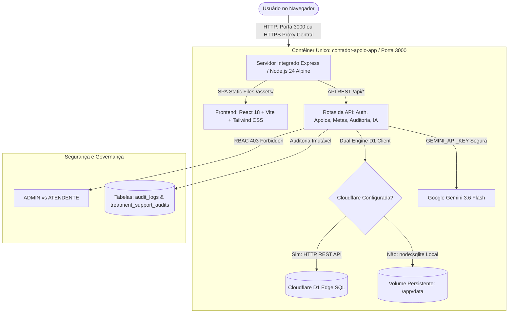

# Arquitetura Técnica do Sistema — Apoio ao Tratamento

## 1. Visão Geral da Arquitetura

O sistema **Apoio ao Tratamento** foi refatorado e desenhado seguindo padrões corporativos modernos de engenharia de software, desacoplado de dependências proprietárias da nuvem AWS Amplify. A persistência é baseada no **Cloudflare D1** (SQLite distribuído na rede da Cloudflare), conteinerizado via **Docker** e orquestrado com **Docker Compose**.

---

## 2. Diagrama de Fluxo de Dados e Componentes

---

## 3. Banco de Dados Cloudflare D1

O **Cloudflare D1** opera sob o motor relacional SQLite com conformidade ACID e replicação distribuída.

### 3.1. Estrutura de Tabelas:
1. `user_profiles`: Perfis de usuário, papéis (`ADMIN` / `ATENDENTE`), status ativo e auditoria de login.
2. `attendants`: Cadastro único de atendentes farmacêuticos (`code` único).
3. `treatment_supports`: Registros de apoios ao tratamento, com suporte a **Soft Delete** (`deleted_at`, `deleted_by`) e **Concorrência Otimista** (`version`).
4. `treatment_support_audits`: Trilha de auditoria rastreando antes (`old_value`) e depois (`new_value`) para mutações `CREATE`, `UPDATE`, `DELETE`, `RESTORE`.
5. `goals`: Metas operacionais por loja e por atendente com versionamento temporal.
6. `ai_analyses`: Cache de pareceres analíticos gerados pelo Google Gemini associados a um hash determinístico (`input_hash`).
7. `audit_logs`: Logs de segurança do sistema (autenticação, falhas, redefinição de senhas, alterações de permissão).
8. `system_settings`: Configurações operacionais e credenciais protegidas no backend.

---

## 4. Estratégia de Isolamento e RBAC (Role-Based Access Control)

| Recurso / Rota | Perfil ADMIN | Perfil ATENDENTE | Ação de Bloqueio |
| :--- | :--- | :--- | :--- |
| `/dashboard` | Leitura Completa | Leitura Restrita/Pessoal | 200 OK |
| `/registrar-apoio` | Gravação Permitida | Acesso Proibido | 403 Forbidden |
| `/lancamentos` | CRUD + Soft Delete + Restore | Acesso Proibido | 403 Forbidden |
| `/atendentes` | Cadastro e Ativação | Acesso Proibido | 403 Forbidden |
| `/metas` | Versionamento e Ajuste | Acesso Proibido | 403 Forbidden |
| `/relatorios` | Exportação e Análise | Acesso Proibido | 403 Forbidden |
| `/usuarios` | Criação, Edição, Status e Reset de Senha | Acesso Proibido | 403 Forbidden |
| `/auditoria` | Visualização Total de Trilha | Acesso Proibido | 403 Forbidden |
| `/configuracoes` | Parâmetros, IA e Chaves do Sistema | Acesso Proibido | 403 Forbidden |
| `/perfil` | Visualização e Troca Senha | Visualização e Troca Senha | 200 OK |

---

## 5. Inteligência Artificial com Proteção de Segredos

1. **Persistência Segura**: A chave `GEMINI_API_KEY` é injetada exclusivamente no contêiner do backend (via variáveis de ambiente ou tabela `system_settings`). O frontend nunca tem acesso à credencial em texto plano.
2. **Cálculo Determinístico**: O backend calcula previamente todos os dados estatísticos (volumes, aderência a metas, médias e projeções).
3. **Cache Determinístico**: Se o hash dos dados oficiais calculados (`input_hash`) for idêntico ao registrado em `ai_analyses`, a análise é retornada do cache sem custo adicional de token.
4. **Invalidação Atômica**: Qualquer criação, edição, exclusão ou restauração de apoio invalida instantaneamente o cache analítico do período afetado.

---

## 6. Conteinerização com Docker e Docker Compose (Single Container)

* **Multi-Stage Build**: O `Dockerfile` unificado compila os artefatos estáticos do Frontend (React + Vite) no Estágio 1, compila o código TypeScript do Backend no Estágio 2 e gera uma imagem de runtime enxuta baseada em `node:24-alpine` no Estágio 3.
* **Execução Não-Root**: O contêiner opera com o usuário seguro nativo `node`, preservando permissões estritas no volume persistente `/app/data`.
* **Healthcheck Integrado**: O healthcheck utiliza o `fetch` nativo do Node 24 para verificar periodicamente a disponibilidade do endpoint `/api/health` sem depender de pacotes externos como `curl`.
* **Zero Overhead**: Elimina a necessidade de redes internas inter-contêineres, orquestração de dependências (`depends_on`), proxies duplicados e conflitos de portas na VPS.
