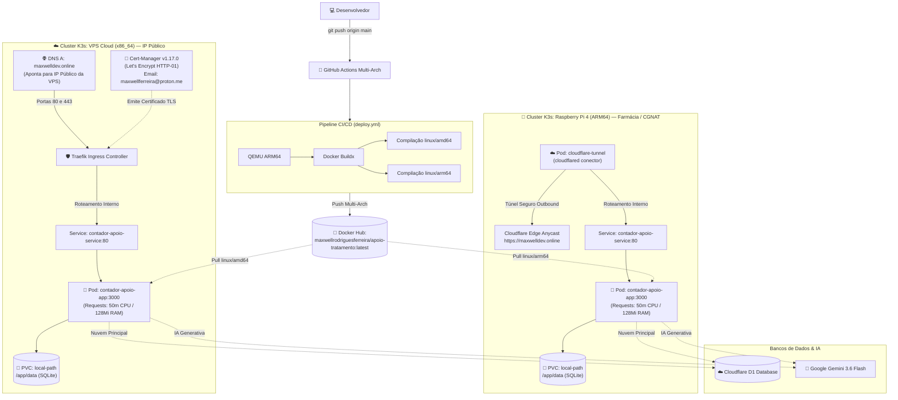

# Manual Prático de Implementação Kubernetes (K3s) — Raspberry Pi 4 (ARM64) & VPS Cloud (x86_64)

> **Guia passo a passo definitivo** para provisionamento, orquestração de contêineres, armazenamento persistente, roteamento de borda vs nuvem, segurança e governança do sistema **Apoio ao Tratamento** utilizando **K3s** (distribuição Kubernetes leve e certificada pela CNCF).
>
> * **Imagem Oficial no Docker Hub**: [`maxwellrodriguesferreira/apoio-tratamento:latest`](https://hub.docker.com/r/maxwellrodriguesferreira/apoio-tratamento) (compilação simultânea multi-arch `linux/amd64` e `linux/arm64`).
> * **Domínio Pessoal Configurado**: `maxwelldev.online` (e `www.maxwelldev.online`).
> * **E-mail de Notificação SSL Let's Encrypt**: `maxwellferreira@proton.me`.
> * **Pré-requisito Vital de Portas**: **Desativação do Nginx Proxy Manager (NPM)** para liberar as portas `80` e `443` para o K3s Traefik Ingress.
> * **Estratégias de Exposição por Ambiente**:
>   * 🍓 **Raspberry Pi 4 (Borda / Farmácia)**: Utiliza **Cloudflare Tunnel (cloudflared)** rodando como Pod in-cluster para contornar CGNAT sem abrir portas no roteador da farmácia.
>   * ☁️ **VPS Cloud (Nuvem / IP Público)**: Utiliza **Traefik Ingress Controller** nativo do K3s com **Cert-Manager** para emissão e renovação automática de certificados SSL/TLS da Let's Encrypt para `maxwelldev.online`.

---

## 📑 Sumário

1. [Topologia e Arquitetura do Kubernetes](#1-topologia-e-arquitetura-do-kubernetes)
2. [Desativação do Nginx Proxy Manager (Liberação das Portas 80 e 443)](#2-desativação-do-nginx-proxy-manager-liberação-das-portas-80-e-443)
3. [Requisitos de Hardware & Sistemas Homologados](#3-requisitos-de-hardware--sistemas-homologados)
4. [Etapa 1: Preparação do Sistema Operacional](#4-etapa-1-preparação-do-sistema-operacional)
   * [4.1. Ajustes Obrigatórios para Raspberry Pi 4 (cgroups e ZRAM)](#41-ajustes-obrigatórios-para-raspberry-pi-4-cgroups-e-zram)
   * [4.2. Ajustes para VPS Cloud (Firewall e Portas)](#42-ajustes-para-vps-cloud-firewall-e-portas)
5. [Etapa 2: Instalação e Configuração do K3s](#5-etapa-2-instalação-e-configuração-do-k3s)
   * [5.1. Instalação na Raspberry Pi 4](#51-instalação-na-raspberry-pi-4)
   * [5.2. Instalação na VPS Cloud](#52-instalação-na-vps-cloud)
   * [5.3. Configuração de Acesso sem sudo (kubectl)](#53-configuração-de-acesso-sem-sudo-kubectl)
6. [Etapa 3: Configuração de Segredos (Secret) e ConfigMap](#6-etapa-3-configuração-de-segredos-secret-e-configmap)
7. [Etapa 4: Implementação na Raspberry Pi 4 com Cloudflare Tunnel](#7-etapa-4-implementação-na-raspberry-pi-4-com-cloudflare-tunnel)
   * [7.1. Criação do Túnel no Cloudflare Zero Trust](#71-criação-do-túnel-no-cloudflare-zero-trust)
   * [7.2. Aplicação do Conector cloudflared in-Cluster](#72-aplicação-do-conector-cloudflared-in-cluster)
8. [Etapa 5: Implementação na VPS Cloud com Traefik + Cert-Manager TLS](#8-etapa-5-implementação-na-vps-cloud-com-traefik--cert-manager-tls)
   * [8.1. Apontamento de DNS para maxwelldev.online](#81-apontamento-de-dns-para-maxwelldevonline)
   * [8.2. Instalação do Cert-Manager v1.17.0](#82-instalação-do-cert-manager-v1170)
   * [8.3. Emissão Automática de SSL com maxwellferreira@proton.me](#83-emissão-automática-de-ssl-com-maxwellferreiraprotonme)
9. [Etapa 6: Deploy da Aplicação (Kustomize ou All-in-One)](#9-etapa-6-deploy-da-aplicação-kustomize-ou-all-in-one)
10. [Etapa 7: Ciclo de Atualização Contínua (CI/CD Rollout)](#10-etapa-7-ciclo-de-atualização-contínua-cicd-rollout)
11. [Etapa 8: Backup, Monitoramento e Persistência SQLite](#11-etapa-8-backup-monitoramento-e-persistência-sqlite)
12. [Etapa 9: Troubleshooting e Diagnóstico Rápido](#12-etapa-9-troubleshooting-e-diagnóstico-rápido)
13. [Quadro Comparativo: Raspberry Pi 4 vs VPS](#13-quadro-comparativo-raspberry-pi-4-vs-vps)

---

## 1. Topologia e Arquitetura do Kubernetes



---

## 2. Desativação do Nginx Proxy Manager (Liberação das Portas 80 e 443)

> ⚠️ **MANDATÓRIO ANTES DE INSTALAR O KUBERNETES**:
> O **Traefik Ingress Controller** (embutido nativamente no K3s) escuta diretamente nas portas de rede **80** (HTTP) e **443** (HTTPS).
> Se o **Nginx Proxy Manager** (ou contêineres Docker antigos) estiver em execução no host, o K3s falhará com erro de `bind: address already in use`.

### 2.1. Localizar e Parar o Nginx Proxy Manager:
Se o NPM foi instalado via Docker ou Docker Compose:

```bash
# Caso esteja rodando como contêiner avulso:
sudo docker stop nginx-proxy-manager npm-db portainer 2>/dev/null || true
sudo docker rm -f nginx-proxy-manager npm-db 2>/dev/null || true

# Caso tenha sido iniciado via docker compose:
# (Execute dentro da pasta onde o compose do NPM reside)
sudo docker compose down 2>/dev/null || true
```

### 2.2. Desativar a inicialização automática do Docker (Opcional se for migrar 100% para K3s):
Caso não vá mais utilizar o daemon do Docker no host:
```bash
sudo systemctl stop docker
sudo systemctl disable docker
```
> *Nota: O K3s utiliza seu próprio runtime de contêineres embutido (`containerd`), não dependendo do daemon do Docker para funcionar.*

### 2.3. Verificar se as portas 80 e 443 estão realmente livres:
```bash
sudo ss -tulpn | grep -E ':(80|443)\b'
```
Se o comando não retornar nenhuma linha, as portas estão completamente desimpedidas para o K3s assumir o controle.

---

## 3. Requisitos de Hardware & Sistemas Homologados

| Especificação | 🍓 Raspberry Pi 4 (Borda) | ☁️ VPS Cloud (Hostinger, Hetzner, etc.) |
| :--- | :--- | :--- |
| **Arquitetura de CPU** | `arm64` / `aarch64` (ARM Cortex-A72) | `x86_64` / `amd64` (Intel Xeon / AMD EPYC) |
| **Memória RAM** | 2 GB, 4 GB ou 8 GB (Recomendado 4 GB) | 1 GB, 2 GB ou 4 GB (Recomendado 2 GB) |
| **Armazenamento** | 32 GB+ MicroSD Classe A2 ou SSD USB 3.0 | 20 GB+ NVMe SSD |
| **Sistema Operacional** | **Raspberry Pi OS Lite 64-bit** (Debian Bookworm) | **Ubuntu 24.04 LTS** ou **Debian 12** |
| **Domínio Pessoal** | `maxwelldev.online` (via Cloudflare Tunnel) | `maxwelldev.online` (via DNS Registro A) |
| **Exposição Externa** | Cloudflare Tunnel in-cluster (Bypass CGNAT) | Traefik Ingress + Let's Encrypt TLS |
| **SSL / TLS** | Terminado automaticamente na Cloudflare Edge | Cert-Manager (`maxwellferreira@proton.me`) |
| **Portas Abertas no Modem**| **NENHUMA** (Túnel outbound criptografado) | Portas 80 e 443 liberadas no Firewall |

---

## 4. Etapa 1: Preparação do Sistema Operacional

Execute os comandos a seguir conectado via SSH no servidor host:

### 4.1. Ajustes Obrigatórios para Raspberry Pi 4 (cgroups e ZRAM)

O kernel Linux da Raspberry Pi precisa ativar explicitamente os controladores de `cgroups` de memória para que o Kubernetes consiga isolar os recursos dos pods.

#### 1. Ativar cgroups no boot da Raspberry Pi:
```bash
sudo nano /boot/firmware/cmdline.txt
# (ou sudo nano /boot/cmdline.txt em versões anteriores do OS)
```
Adicione **ao final da linha única** existente (separado por um espaço):
```text
cgroup_enable=cpuset cgroup_memory=1 cgroup_enable=memory
```
Salve com `Ctrl+O`, `Enter` e saia com `Ctrl+X`.

#### 2. Ativar ZRAM e Preservação do Cartão MicroSD:
```bash
sudo apt update && sudo apt upgrade -y
sudo apt install -y curl wget git nano ca-certificates zram-tools open-iscsi

# Ativa swap comprimido em memória ZRAM (reduz uso do MicroSD)
sudo tee /etc/default/zramswap << 'EOF'
ALGO=zstd
PERCENT=50
PRIORITY=100
EOF
sudo systemctl restart zramswap

# Reduz tendência de gravação em disco
echo 'vm.swappiness=10' | sudo tee -a /etc/sysctl.conf
sudo sysctl -p

# Reinicie a Raspberry Pi para ativar as diretivas do kernel
sudo reboot
```

---

### 4.2. Ajustes para VPS Cloud (Firewall e Portas)

Na VPS, configure o firewall UFW garantindo a liberação do tráfego web direto:
```bash
sudo apt update && sudo apt upgrade -y
sudo apt install -y curl wget git nano ca-certificates open-iscsi ufw

# Configurar regras básicas do Firewall
sudo ufw default deny incoming
sudo ufw default allow outgoing
sudo ufw allow 22/tcp    # SSH
sudo ufw allow 80/tcp    # HTTP (Desafio Let's Encrypt / Traefik)
sudo ufw allow 443/tcp   # HTTPS (Tráfego seguro com TLS)
sudo ufw --force enable
```

---

## 5. Etapa 2: Instalação e Configuração do K3s

### 5.1. Instalação na Raspberry Pi 4

Na Raspberry Pi 4, instalamos o K3s com flags que otimizam o uso de memória:
```bash
curl -sfL https://get.k3s.io | sh -s - \
  --write-kubeconfig-mode 644 \
  --prefer-bundled-bin
```

---

### 5.2. Instalação na VPS Cloud

Na VPS, onde utilizaremos o Traefik nativo para receber as conexões de `maxwelldev.online`:
```bash
curl -sfL https://get.k3s.io | sh -s - \
  --write-kubeconfig-mode 644 \
  --tls-san $(curl -s ifconfig.me)
```

---

### 5.3. Configuração de Acesso sem sudo (kubectl)

Permita que o usuário gerencie o cluster diretamente:
```bash
mkdir -p ~/.kube
sudo cp /etc/rancher/k3s/k3s.yaml ~/.kube/config
sudo chown -R $USER:$USER ~/.kube
echo 'export KUBECONFIG=~/.kube/config' >> ~/.bashrc
source ~/.bashrc

# Testar se o cluster está saudável
kubectl get nodes -o wide
```
Aguarde até que o nó apresente o status **Ready**.

---

## 6. Etapa 3: Configuração de Segredos (Secret) e ConfigMap

Clone o repositório na máquina:
```bash
git clone https://github.com/maxwellrodriguesferreira/contador-apoio-tratamento.git
cd contador-apoio-tratamento
```

### 6.1. Criar o Namespace:
```bash
kubectl apply -f k8s/base/namespace.yaml
```

### 6.2. Criar a Secret com suas Credenciais Seguras:

#### Opção A (A partir do arquivo `.env` já preenchido — Recomendado):
```bash
kubectl create secret generic contador-apoio-secret \
  --namespace=contador-apoio \
  --from-env-file=.env \
  --dry-run=client -o yaml | kubectl apply -f -
```

#### Opção B (Via arquivo YAML modelo):
```bash
cp k8s/base/secret.example.yaml k8s/base/secret.yaml
nano k8s/base/secret.yaml
# Insira suas chaves do Cloudflare D1, Gemini AI e Senhas
kubectl apply -f k8s/base/secret.yaml
```

---

## 7. Etapa 4: Implementação na Raspberry Pi 4 com Cloudflare Tunnel

Como a Raspberry Pi opera sob **CGNAT** na farmácia, o conector **cloudflared** roda dentro do cluster e conecta com a Cloudflare sem abrir nenhuma porta no roteador.

### 7.1. Criação do Túnel no Cloudflare Zero Trust:
1. Acesse o painel **[Cloudflare Zero Trust](https://one.dash.cloudflare.com/)**.
2. Navegue até **Networks** > **Tunnels** > **Add a tunnel**.
3. Selecione o conector **Cloudflared** e dê o nome: `k8s-rpi4-farmacia`.
4. Copie o **token** do túnel exibido (o valor alfanumérico longo após `--token`).
5. Configure o **Public Hostname**:
   * **Domain**: `maxwelldev.online` (ou subdomínio como `apoio.maxwelldev.online`).
   * **Service Type**: `HTTP`
   * **URL**: `contador-apoio-service.contador-apoio.svc.cluster.local:80`

### 7.2. Aplicação do Conector cloudflared in-Cluster:
Gere a secret do token no cluster:
```bash
kubectl create secret generic cloudflare-tunnel-token \
  --namespace=contador-apoio \
  --from-literal=token="SEU_TOKEN_DO_TUNEL_COPIADO_AQUI"
```

Em seguida, aplique os manifestos da Raspberry Pi 4:
```bash
# Método Kustomize:
kubectl apply -k k8s/overlays/rpi4/

# OU Método Manifesto Único:
# kubectl apply -f k8s/rpi4-all-in-one.yaml
```

Verifique se o túnel conectou com sucesso:
```bash
kubectl logs -f deployment/cloudflare-tunnel -n contador-apoio
```
Você verá a mensagem: `Registered tunnel connection ... Connection established`. O sistema já estará acessível publicamente em `https://maxwelldev.online`!

---

## 8. Etapa 5: Implementação na VPS Cloud com Traefik + Cert-Manager TLS

### 8.1. Apontamento de DNS para maxwelldev.online:
No seu gerenciador de DNS (Cloudflare, Registro.br ou provedor do domínio):
* Crie um **Registro A**:
  * **Nome**: `@` (ou `maxwelldev.online`)
  * **Destino / IPv4**: `IP_PUBLICO_DA_SUA_VPS`
  * **Proxy Cloudflare**: Apenas DNS (*DNS only* / Nuvem Cinza) durante a emissão inicial.
* Crie um **Registro A** adicional para `www`:
  * **Nome**: `www`
  * **Destino / IPv4**: `IP_PUBLICO_DA_SUA_VPS`

### 8.2. Instalação do Cert-Manager v1.17.0:
Instale o Cert-Manager oficial para gerenciar o ciclo de vida dos certificados SSL:
```bash
kubectl apply -f https://github.com/cert-manager/cert-manager/releases/download/v1.17.0/cert-manager.yaml

# Aguarde até que todos os 3 pods do cert-manager fiquem Running:
kubectl get pods -n cert-manager --watch
```
Pressione `Ctrl+C` quando estiverem ativos.

### 8.3. Emissão Automática de SSL com maxwellferreira@proton.me:
Os manifestos [`k8s/overlays/vps/issuer.yaml`](file:///home/maxwell/contador-apoio-tratamento/k8s/overlays/vps/issuer.yaml) e [`k8s/vps-all-in-one.yaml`](file:///home/maxwell/contador-apoio-tratamento/k8s/vps-all-in-one.yaml) já estão configurados com o e-mail:
```yaml
apiVersion: cert-manager.io/v1
kind: Issuer
metadata:
  name: letsencrypt-contador-apoio
  namespace: contador-apoio
spec:
  acme:
    server: https://acme-v02.api.letsencrypt.org/directory
    email: maxwellferreira@proton.me
    privateKeySecretRef:
      name: letsencrypt-account-key
    solvers:
      - http01:
          ingress:
            class: traefik
```

Aplique os recursos na VPS:
```bash
# Método Kustomize:
kubectl apply -k k8s/overlays/vps/

# OU Método Manifesto Único:
# kubectl apply -f k8s/vps-all-in-one.yaml
```

Acompanhe a emissão do certificado Let's Encrypt:
```bash
kubectl get certificate -n contador-apoio --watch
```
Quando o campo **READY** marcar `True`, o certificado foi emitido e injetado automaticamente no Traefik Ingress. Acesse: `https://maxwelldev.online`.

---

## 9. Etapa 6: Deploy da Aplicação (Kustomize ou All-in-One)

Para implantar ou atualizar todos os componentes com uma única linha de comando:

### Na Raspberry Pi 4:
```bash
kubectl apply -k k8s/overlays/rpi4/
```

### Na VPS Cloud:
```bash
kubectl apply -k k8s/overlays/vps/
```

### Verificação do Status dos Pods:
```bash
kubectl get pods,svc,pvc,ingress -n contador-apoio -o wide
```
Saída esperada:
```text
NAME                                      READY   STATUS    RESTARTS   AGE
pod/contador-apoio-app-6997b6cf9c-98vwk   1/1     Running   0          45s
pod/cloudflare-tunnel-789cf6d78-x2z7p     1/1     Running   0          1m

NAME                             TYPE        CLUSTER-IP      PORT(S)   AGE
service/contador-apoio-service   ClusterIP   10.43.120.45    80/TCP    1m

NAME                                            STATUS   VOLUME                                     CAPACITY
persistentvolumeclaim/contador-apoio-data-pvc   Bound    pvc-1a2b3c4d-5e6f-7a8b-9c0d-1e2f3a4b5c6d   2Gi
```

---

## 10. Etapa 7: Ciclo de Atualização Contínua (CI/CD Rollout)

Quando um novo código é enviado para a branch `main`, a pipeline do **GitHub Actions** compila os binários multiplataforma (`linux/amd64` e `linux/arm64`) e publica a imagem no Docker Hub:
`maxwellrodriguesferreira/apoio-tratamento:latest`

Para atualizar a aplicação em produção com **Zero Downtime**:

```bash
# Força o download da nova imagem e reinicia os pods de forma graciosa:
kubectl rollout restart deployment/contador-apoio-app -n contador-apoio

# Acompanha a substituição do pod:
kubectl rollout status deployment/contador-apoio-app -n contador-apoio
```

---

## 11. Etapa 8: Backup, Monitoramento e Persistência SQLite

### 11.1. Localização Física dos Dados no Host:
O provisionador nativo `local-path` do K3s grava os dados do volume persistente diretamente no host em:
```text
/var/lib/rancher/k3s/storage/pvc-UUID_contador-apoio_contador-apoio-data-pvc/
```

### 11.2. Script Automatizado de Backup Quente (Hot Backup):
```bash
sudo tee /usr/local/bin/backup-k8s-apoio.sh << 'EOF'
#!/bin/bash
BACKUP_DIR="/root/backups_apoio_k8s"
TIMESTAMP=$(date +"%Y%m%d_%H%M%S")
mkdir -p "$BACKUP_DIR"

POD_NAME=$(kubectl get pod -n contador-apoio -l app.kubernetes.io/name=contador-apoio -o jsonpath="{.items[0].metadata.name}")

if [ -n "$POD_NAME" ]; then
    kubectl exec -n contador-apoio "$POD_NAME" -- sqlite3 /app/data/local.sqlite ".backup '/app/data/backup_temp.sqlite'" 2>/dev/null || true
    kubectl cp -n contador-apoio "$POD_NAME":/app/data/backup_temp.sqlite "$BACKUP_DIR/db_${TIMESTAMP}.sqlite" 2>/dev/null || true
    gzip -9 "$BACKUP_DIR/db_${TIMESTAMP}.sqlite"
    find "$BACKUP_DIR" -type f -name "*.sqlite.gz" -mtime +14 -delete
    echo "[OK] Backup gerado: $BACKUP_DIR/db_${TIMESTAMP}.sqlite.gz"
else
    echo "[ERRO] Pod da aplicação não encontrado."
fi
EOF

sudo chmod +x /usr/local/bin/backup-k8s-apoio.sh
```

---

## 12. Etapa 9: Troubleshooting e Diagnóstico Rápido

### 1. Conflito de porta 80/443 ao iniciar o K3s Traefik Ingress:
* **Sintoma**: Pod do Traefik em `CrashLoopBackOff` ou porta 80 inacessível.
* **Causa**: O **Nginx Proxy Manager** ainda está rodando no Docker host.
* **Solução**:
  ```bash
  sudo docker stop nginx-proxy-manager npm-db 2>/dev/null || true
  sudo docker compose down 2>/dev/null || true
  sudo systemctl restart k3s
  ```

### 2. Pod em `CrashLoopBackOff` com erro de permissão no SQLite:
* **Causa**: Volume com permissão root no host.
* **Solução**: O deployment já usa `securityContext.fsGroup: 1000`. Para forçar a permissão:
  ```bash
  sudo chown -R 1000:1000 /var/lib/rancher/k3s/storage/*contador-apoio*
  ```

### 3. K3s não inicia na Raspberry Pi 4 (`failed to find memory cgroup`):
* **Causa**: Parâmetros de `cgroups` ausentes no `/boot/firmware/cmdline.txt`.
* **Solução**: Certifique-se de que `cgroup_enable=cpuset cgroup_memory=1 cgroup_enable=memory` esteja inserido em **linha única** e reinicie a placa com `sudo reboot`.

### 4. Falha na emissão do Certificado SSL Let's Encrypt na VPS:
* **Diagnóstico**:
  ```bash
  kubectl describe certificate contador-apoio-tls -n contador-apoio
  kubectl describe challenge -n contador-apoio
  ```
* **Causa**: Registro DNS A de `maxwelldev.online` não propagou ou o firewall UFW está bloqueando a porta 80 (`sudo ufw allow 80/tcp`).

---

## 13. Quadro Comparativo: Raspberry Pi 4 vs VPS

| Critério | 🍓 Raspberry Pi 4 (Borda / Farmácia) | ☁️ VPS Cloud (Nuvem / Hostinger) |
| :--- | :--- | :--- |
| **Distribuição Kubernetes** | K3s (Consumo ~450 MB RAM) | K3s (Consumo ~550 MB RAM) |
| **Arquitetura de Compilação** | `linux/arm64` | `linux/amd64` |
| **Tipo de Conexão de Rede** | Sem IP fixo / CGNAT | Endereço IPv4 Público Estático |
| **Estratégia de Exposição** | **Cloudflare Tunnel in-cluster** | **Traefik Ingress + Let's Encrypt TLS** |
| **Domínio Configurado** | `maxwelldev.online` | `maxwelldev.online` / `www.maxwelldev.online` |
| **E-mail SSL** | Gerenciado na Cloudflare Edge | `maxwellferreira@proton.me` (Cert-Manager) |
| **Abertura de Portas no Roteador** | **0 portas abertas** (Zero Trust) | Portas 80 e 443 abertas no Firewall |
| **Nginx Proxy Manager** | **Desativado** (Liberar RAM) | **Desativado** (Liberar portas 80/443 para Traefik) |

---
*Manual elaborado especificamente para o ecossistema Apoio ao Tratamento.*
