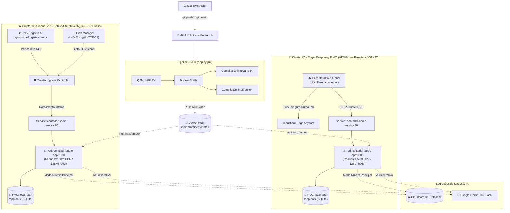

# Manual Prático de Implementação Kubernetes (K3s) — Raspberry Pi (ARM64) & VPS Cloud (x86_64)

> **Guia passo a passo completo** para provisionamento, orquestração de contêineres, armazenamento persistente, roteamento de borda vs nuvem, segurança e governança do sistema **Apoio ao Tratamento** utilizando **K3s** (distribuição Kubernetes leve e certificada pela CNCF).
>
> * **Imagem Oficial no Docker Hub**: [`maxwellrodriguesferreira/apoio-tratamento:latest`](https://hub.docker.com/r/maxwellrodriguesferreira/apoio-tratamento) (compilação simultânea multi-arch `linux/amd64` e `linux/arm64`).
> * **Orquestrador**: **K3s** (consumo ultra-reduzido de ~500 MB de RAM, ideal para placas Raspberry Pi e VPS de entrada).
> * **Persistência de Dados**: **Local Path Provisioner** nativo do K3s montado em `/app/data` para o motor SQLite local híbrido com Cloudflare D1.
> * **Estratégias de Exposição**:
>   * 🍓 **Raspberry Pi (Borda / Farmácia)**: Utiliza **Cloudflare Tunnel (cloudflared)** rodando como Pod interno para contornar CGNAT sem abrir portas no roteador da farmácia.
>   * ☁️ **VPS Cloud (Nuvem / IP Público)**: Utiliza **Traefik Ingress Controller** nativo com **Cert-Manager** para emissão e renovação automática de certificados SSL/TLS da Let's Encrypt via DNS Direto (Registro A).

---

## 📑 Sumário

1. [Topologia e Arquitetura do Kubernetes](#1-topologia-e-arquitetura-do-kubernetes)
2. [Requisitos de Hardware & Sistemas Homologados](#2-requisitos-de-hardware--sistemas-homologados)
3. [Etapa 1: Preparação do Sistema Operacional](#3-etapa-1-preparação-do-sistema-operacional)
   * [3.1. Ajustes Obrigatórios para Raspberry Pi (cgroups e ZRAM)](#31-ajustes-obrigatórios-para-raspberry-pi-cgroups-e-zram)
   * [3.2. Ajustes para VPS Cloud (Firewall e Segurança)](#32-ajustes-para-vps-cloud-firewall-e-segurança)
4. [Etapa 2: Instalação e Configuração do K3s](#4-etapa-2-instalação-e-configuração-do-k3s)
   * [4.1. Instalação na VPS Cloud](#41-instalação-na-vps-cloud)
   * [4.2. Instalação na Raspberry Pi](#42-instalação-na-raspberry-pi)
   * [4.3. Configuração do Acesso via kubectl](#43-configuração-do-acesso-via-kubectl)
5. [Etapa 3: Instalação do Cert-Manager (Exclusivo para VPS)](#5-etapa-3-instalação-do-cert-manager-exclusivo-para-vps)
6. [Etapa 4: Configuração de Variáveis (ConfigMap) e Segredos (Secret)](#6-etapa-4-configuração-de-variáveis-configmap-e-segredos-secret)
7. [Etapa 5: Roteamento de Rede e Exposição](#7-etapa-5-roteamento-de-rede-e-exposição)
   * [5.1. Cenário Raspberry Pi: Cloudflare Tunnel in-Cluster (Bypass CGNAT)](#51-cenário-raspberry-pi-cloudflare-tunnel-in-cluster-bypass-cgnat)
   * [5.2. Cenário VPS Cloud: Traefik Ingress + Let's Encrypt TLS](#52-cenário-vps-cloud-traefik-ingress--lets-encrypt-tls)
8. [Etapa 6: Deploy da Aplicação no Cluster](#8-etapa-6-deploy-da-aplicação-no-cluster)
9. [Etapa 7: Deploy Alternativo via Portainer Kubernetes](#9-etapa-7-deploy-alternativo-via-portainer-kubernetes)
10. [Etapa 8: Ciclo de Atualização Contínua (CI/CD Rollout)](#10-etapa-8-ciclo-de-atualização-contínua-cicd-rollout)
11. [Etapa 9: Rotinas de Backup, Monitoramento e Manutenção](#11-etapa-9-rotinas-de-backup-monitoramento-e-manutenção)
12. [Etapa 10: Troubleshooting e Resolução de Problemas](#12-etapa-10-troubleshooting-e-resolução-de-problemas)
13. [Quadro Comparativo: Raspberry Pi vs VPS](#13-quadro-comparativo-raspberry-pi-vs-vps)

---

## 1. Topologia e Arquitetura do Kubernetes



---

## 2. Requisitos de Hardware & Sistemas Homologados

| Componente | Raspberry Pi 4 / 5 (Borda) | VPS Cloud (Hostinger, Hetzner, etc.) |
| :--- | :--- | :--- |
| **Arquitetura de CPU** | `arm64` / `aarch64` (ARM Cortex-A72 / A76) | `x86_64` / `amd64` (Intel Xeon / AMD EPYC) |
| **Memória RAM** | 2 GB, 4 GB ou 8 GB (Recomendado: 4 GB+) | 1 GB, 2 GB ou 4 GB (Recomendado: 2 GB+) |
| **Armazenamento** | 32 GB+ MicroSD Classe A2 ou SSD USB 3.0 | 20 GB+ NVMe SSD |
| **Sistema Operacional** | **Raspberry Pi OS Lite 64-bit** (Debian 12 Bookworm) | **Ubuntu 24.04 LTS** ou **Debian 12 Bookworm** |
| **Conectividade Externa** | Sem IP fixo / CGNAT (Requer Cloudflare Tunnel) | IP Público IPv4 Estático Dedicado (DNS Registro A) |
| **Provisionador Storage** | `local-path` nativo do K3s | `local-path` nativo do K3s |
| **Ingress Controller** | Traefik embutido ou Cloudflare Tunnel | Traefik nativo embutido |

> ⚠️ **Aviso Crítico para Raspberry Pi**: O uso de sistema operacional de **64 bits** é estritamente obrigatório. Imagens de 32 bits (`armhf`) falharão na execução de contêineres modernos baseados em Node.js 24 Alpine.

---

## 3. Etapa 1: Preparação do Sistema Operacional

Execute os comandos a seguir logado via SSH no servidor host:

### 3.1. Ajustes Obrigatórios para Raspberry Pi (cgroups e ZRAM)

O K3s necessita dos controladores de memória do kernel Linux (`cgroups`) ativados para isolar a memória dos pods.

#### 1. Ativar cgroups no kernel da Raspberry Pi:
Verifique o arquivo de boot correspondente à sua versão do Raspberry Pi OS:

```bash
# No Raspberry Pi OS Bookworm (recente):
sudo nano /boot/firmware/cmdline.txt

# Caso o diretório acima não exista (versões anteriores):
# sudo nano /boot/cmdline.txt
```

Adicione **ao final da mesma linha** (não quebre em novas linhas), separado por espaço:
```text
cgroup_enable=cpuset cgroup_memory=1 cgroup_enable=memory
```
Salve o arquivo com `Ctrl+O`, `Enter` e feche com `Ctrl+X`.

#### 2. Configurar ZRAM e Preservação do MicroSD:
Evite travamentos por falta de memória RAM física comprimindo a memória dinamicamente:
```bash
sudo apt update && sudo apt upgrade -y
sudo apt install -y curl wget git nano ca-certificates zram-tools open-iscsi

# Configura ZRAM com algoritmo zstd ocupando até 50% da RAM
sudo tee /etc/default/zramswap << 'EOF'
ALGO=zstd
PERCENT=50
PRIORITY=100
EOF
sudo systemctl restart zramswap

# Reduz o uso agressivo de gravação no cartão de memória
echo 'vm.swappiness=10' | sudo tee -a /etc/sysctl.conf
sudo sysctl -p

# Reinicie a Raspberry Pi para carregar os novos parâmetros do kernel
sudo reboot
```

---

### 3.2. Ajustes para VPS Cloud (Firewall e Segurança)

Em sua VPS com Ubuntu ou Debian:
```bash
sudo apt update && sudo apt upgrade -y
sudo apt install -y curl wget git nano ca-certificates open-iscsi ufw

# Configurar Firewall UFW
sudo ufw default deny incoming
sudo ufw default allow outgoing
sudo ufw allow 22/tcp    # SSH
sudo ufw allow 80/tcp    # HTTP (Let's Encrypt / Ingress)
sudo ufw allow 443/tcp   # HTTPS (TLS / Ingress)

# Caso deseje administrar o cluster remotamente do seu PC (opcional):
# sudo ufw allow 6443/tcp # K3s Kubernetes API Server

sudo ufw --force enable
```

---

## 4. Etapa 2: Instalação e Configuração do K3s

O **K3s** é empacotado como um binário único e leve que instala automaticamente `containerd`, `flannel`, `CoreDNS`, `metrics-server`, `Traefik` e o provisionador de storage `local-path`.

### 4.1. Instalação na VPS Cloud

Na VPS, onde utilizaremos o Traefik nativo para receber conexões públicas nas portas 80 e 443:
```bash
curl -sfL https://get.k3s.io | sh -s - \
  --write-kubeconfig-mode 644 \
  --tls-san $(curl -s ifconfig.me)
```

---

### 4.2. Instalação na Raspberry Pi

Na Raspberry Pi, para economizar o máximo de memória RAM e recursos da CPU para a aplicação:
```bash
curl -sfL https://get.k3s.io | sh -s - \
  --write-kubeconfig-mode 644 \
  --prefer-bundled-bin
```

---

### 4.3. Configuração do Acesso via kubectl

Por padrão, o K3s instala o `kubectl` em `/usr/local/bin/kubectl`. Para permitir que o seu usuário comum gerencie o cluster sem necessitar de `sudo`:

```bash
mkdir -p ~/.kube
sudo cp /etc/rancher/k3s/k3s.yaml ~/.kube/config
sudo chown -R $USER:$USER ~/.kube
echo 'export KUBECONFIG=~/.kube/config' >> ~/.bashrc
source ~/.bashrc

# Testar se o cluster está operacional:
kubectl get nodes -o wide
```

A saída esperada deve apresentar o nó com o status **Ready**:
```text
NAME       STATUS   ROLES                  AGE   VERSION        INTERNAL-IP
rpi-farm   Ready    control-plane,master   1m    v1.31.x+k3s1   192.168.1.100
```

---

## 5. Etapa 3: Instalação do Cert-Manager (Exclusivo para VPS)

> 💡 **Nota**: Se você estiver configurando a **Raspberry Pi com Cloudflare Tunnel**, pule esta etapa! O Cloudflare Tunnel cuida de 100% da criptografia e dos certificados SSL na borda automaticamente.

Na VPS, o **Cert-Manager** emitirá certificados SSL válidos da Let's Encrypt para o seu domínio com renovação automática:

```bash
# Instala o Cert-Manager oficial v1.17.0
kubectl apply -f https://github.com/cert-manager/cert-manager/releases/download/v1.17.0/cert-manager.yaml

# Aguarde até que todos os pods estejam em execução (Running):
kubectl get pods -n cert-manager --watch
```

Pressione `Ctrl+C` quando os três pods (`cert-manager`, `cainjector` e `webhook`) estiverem `Running`.

---

## 6. Etapa 4: Configuração de Variáveis (ConfigMap) e Segredos (Secret)

Clone o repositório do projeto no servidor:
```bash
git clone https://github.com/maxwellrodriguesferreira/contador-apoio-tratamento.git
cd contador-apoio-tratamento
```

### 6.1. Criar o Namespace:
```bash
kubectl apply -f k8s/namespace.yaml
```

### 6.2. Configurar o Secret da Aplicação:

Você tem duas maneiras práticas de injetar suas credenciais:

#### Opção A (Direto a partir do seu arquivo `.env` — Mais Fácil):
Se você já possui o arquivo `.env` configurado na raiz do projeto:
```bash
kubectl create secret generic contador-apoio-secret \
  --namespace=contador-apoio \
  --from-env-file=.env \
  --dry-run=client -o yaml | kubectl apply -f -
```

#### Opção B (Via arquivo YAML declarativo):
```bash
cp k8s/secret.example.yaml k8s/secret.yaml
nano k8s/secret.yaml
```
Preencha suas chaves reais:
```yaml
apiVersion: v1
kind: Secret
metadata:
  name: contador-apoio-secret
  namespace: contador-apoio
type: Opaque
stringData:
  CLOUDFLARE_ACCOUNT_ID: "ef579acea3be117e010eafc168ca1c2f"
  CLOUDFLARE_DATABASE_ID: "9e9cb6e6-6981-4357-9c76-acaff75f7377"
  CLOUDFLARE_API_TOKEN: "cfut_seu_token_aqui"
  GEMINI_API_KEY: "sua_chave_gemini_aqui"
  ADMIN_EMAIL: "admin@suadrogaria.com.br"
  ADMIN_PASSWORD: "SuaSenhaSegura123$"
  ATENDENTE_EMAIL: ""
  ATENDENTE_PASSWORD: ""
  REDIS_URL: ""
```
Aplique o manifesto:
```bash
kubectl apply -f k8s/secret.yaml
```

---

## 7. Etapa 5: Roteamento de Rede e Exposição

Escolha a seção correspondente ao seu ambiente:

### 5.1. Cenário Raspberry Pi: Cloudflare Tunnel in-Cluster (Bypass CGNAT)

Como a Raspberry Pi está na rede interna da farmácia sob CGNAT da operadora, não é possível receber conexões externas diretas nas portas 80/443. O conector **cloudflared** roda como um pod dentro do K3s e cria um canal seguro com a Cloudflare.

#### 1. Criar o Túnel no Painel Cloudflare:
1. Acesse o **[Cloudflare Zero Trust](https://one.dash.cloudflare.com/)**.
2. Vá em **Networks** > **Tunnels** > **Create a tunnel**.
3. Selecione o tipo **Cloudflared** e dê o nome: `k8s-rpi-farmacia`.
4. Na tela de instalação, copie apenas o **Token alfanumérico** do túnel exibido no comando de exemplo (o valor após `--token`).

#### 2. Configurar a Rota Pública (Public Hostname):
No painel do túnel na Cloudflare:
* **Public Hostname**: `apoio.suadrogaria.com.br` (ou o domínio desejado).
* **Service Type**: `HTTP`
* **URL**: `contador-apoio-service.contador-apoio.svc.cluster.local:80`

#### 3. Criar a Secret do Token no Kubernetes:
```bash
kubectl create secret generic cloudflare-tunnel-token \
  --namespace=contador-apoio \
  --from-literal=token="COLE_AQUI_O_TOKEN_DO_TUNEL"
```

#### 4. Aplicar o Pod do Conector:
```bash
kubectl apply -f k8s/cloudflare-tunnel.example.yaml
```

O pod `cloudflare-tunnel` iniciará, conectará aos data centers da Cloudflare e roteará instantaneamente o tráfego do subdomínio público diretamente para o Service interno `contador-apoio-service:80`!

---

### 5.2. Cenário VPS Cloud: Traefik Ingress + Let's Encrypt TLS

Na VPS com IP público dedicado:

#### 1. Apontar o Domínio no seu Provedor de DNS:
Crie um registro do tipo **A**:
* **Nome**: `apoio` (ou `@`)
* **Conteúdo (Destino)**: `IP_PUBLICO_DA_SUA_VPS`
* **TTL**: Automático ou 300 segundos

#### 2. Configurar o Issuer do Cert-Manager:
Edite `k8s/issuer.yaml` e informe o seu e-mail para avisos de renovação:
```yaml
spec:
  acme:
    server: https://acme-v02.api.letsencrypt.org/directory
    email: seu-email@dominio.com.br
```
Aplique o issuer:
```bash
kubectl apply -f k8s/issuer.yaml
```

#### 3. Configurar o Ingress:
Edite `k8s/ingress.yaml` substituindo o host pelo seu domínio:
```yaml
spec:
  ingressClassName: traefik
  tls:
    - hosts:
        - apoio.suadrogaria.com.br
      secretName: contador-apoio-tls
  rules:
    - host: apoio.suadrogaria.com.br
      http:
        paths:
          - path: /
            pathType: Prefix
            backend:
              service:
                name: contador-apoio-service
                port:
                  name: http
```
Aplique o Ingress:
```bash
kubectl apply -f k8s/ingress.yaml
```

---

## 8. Etapa 6: Deploy da Aplicação no Cluster

Com os segredos e a rota de rede prontos, implante os componentes centrais da aplicação:

```bash
# Aplica ConfigMap, PVC, Service e Deployment
kubectl apply -f k8s/configmap.yaml
kubectl apply -f k8s/pvc.yaml
kubectl apply -f k8s/service.yaml
kubectl apply -f k8s/deployment.yaml

# Ou aplique de forma declarativa via Kustomize:
# kubectl apply -k k8s/
```

### Validação do Deploy:
Acompanhe a inicialização dos pods:
```bash
kubectl get pods -n contador-apoio -o wide --watch
```

Aguarde até que o status mude para `Running` e `1/1` no campo READY:
```text
NAME                                  READY   STATUS    RESTARTS   AGE
contador-apoio-app-798cb8c755-k8w54   1/1     Running   0          45s
cloudflare-tunnel-6976f6b965-x4z7k    1/1     Running   0          2m
```

### Verificação do Volume Persistente (PVC):
```bash
kubectl get pvc -n contador-apoio
```
O status deve ser `Bound`, vinculado à StorageClass `local-path`.

### Verificação dos Logs:
```bash
kubectl logs -f deployment/contador-apoio-app -n contador-apoio
```
Você verá o motor SQLite inicializado, as migrações aplicadas e o servidor Express escutando na porta interna 3000.

---

## 9. Etapa 7: Deploy Alternativo via Portainer Kubernetes

Caso prefira gerenciar o cluster visualmente via interface web:

### 9.1. Instalar o Portainer CE dentro do K3s:
```bash
# Cria o namespace e instala o Portainer
kubectl apply -n portainer -f https://raw.githubusercontent.com/portainer/k8s/master/deploy/manifests/portainer/portainer.yaml

# Verificar se o Portainer está ativo:
kubectl get pods -n portainer
```

Acesse a interface web através do IP do servidor na porta NodePort correspondente (ou configure um Ingress para `portainer.seudominio.com`).

### 9.2. Subir a Aplicação via Web Editor:
1. No menu lateral, acesse **Applications** > **Add application** ou **Custom Templates** / **Stacks**.
2. Cole o conteúdo de [`k8s/portainer-all-in-one.example.yaml`](file:///home/maxwell/contador-apoio-tratamento/k8s/portainer-all-in-one.example.yaml).
3. Preencha suas credenciais nos blocos de `Secret` e clique em **Deploy**.

---

## 10. Etapa 8: Ciclo de Atualização Contínua (CI/CD Rollout)

Quando um novo commit é enviado para o branch `main` do GitHub, a esteira do **GitHub Actions** compila automaticamente os binários para `linux/amd64` e `linux/arm64` e publica a nova tag `latest` no Docker Hub.

Para atualizar o cluster em produção com **Zero Downtime**:

```bash
# Força o Kubernetes a baixar a nova imagem e recriar o Pod:
kubectl rollout restart deployment/contador-apoio-app -n contador-apoio

# Acompanhar a troca do pod em tempo real:
kubectl rollout status deployment/contador-apoio-app -n contador-apoio
```

### Automação com Cron Job (Opcional):
Caso deseje que o cluster verifique e aplique atualizações automaticamente todas as madrugadas:
```bash
(crontab -l 2>/dev/null; echo "0 4 * * * /usr/local/bin/kubectl rollout restart deployment/contador-apoio-app -n contador-apoio >/dev/null 2>&1") | crontab -
```

---

## 11. Etapa 9: Rotinas de Backup, Monitoramento e Manutenção

### 11.1. Localização dos Dados do SQLite no Host
O provisionador `local-path` do K3s armazena os arquivos físicos do PersistentVolumeClaim no disco host em:
```text
/var/lib/rancher/k3s/storage/pvc-UUID_contador-apoio_contador-apoio-data-pvc/
```

### 11.2. Script de Backup Quente do Banco de Dados:
Crie um script de backup seguro utilizando a API nativa do SQLite ou cópia do diretório:
```bash
sudo tee /usr/local/bin/backup-k8s-apoio.sh << 'EOF'
#!/bin/bash
BACKUP_DIR="/root/backups_apoio_k8s"
TIMESTAMP=$(date +"%Y%m%d_%H%M%S")
mkdir -p "$BACKUP_DIR"

# Executa cópia snapshot do banco via kubectl exec
POD_NAME=$(kubectl get pod -n contador-apoio -l app.kubernetes.io/name=contador-apoio -o jsonpath="{.items[0].metadata.name}")

if [ -n "$POD_NAME" ]; then
    kubectl exec -n contador-apoio "$POD_NAME" -- sqlite3 /app/data/local.sqlite ".backup '/app/data/backup_temp.sqlite'" 2>/dev/null || true
    kubectl cp -n contador-apoio "$POD_NAME":/app/data/backup_temp.sqlite "$BACKUP_DIR/db_${TIMESTAMP}.sqlite" 2>/dev/null || true
    gzip -9 "$BACKUP_DIR/db_${TIMESTAMP}.sqlite"
    # Mantém apenas os últimos 14 backups
    find "$BACKUP_DIR" -type f -name "*.sqlite.gz" -mtime +14 -delete
    echo "[OK] Backup gerado com sucesso: $BACKUP_DIR/db_${TIMESTAMP}.sqlite.gz"
else
    echo "[ERRO] Pod da aplicação não encontrado."
fi
EOF

sudo chmod +x /usr/local/bin/backup-k8s-apoio.sh
```

---

## 12. Etapa 10: Troubleshooting e Resolução de Problemas

### 1. Pod preso em `CrashLoopBackOff` ou Erro de Permissão no SQLite:
* **Causa**: O volume persistente montado em `/app/data` está com permissões root.
* **Solução**: O manifesto `k8s/deployment.yaml` já define `securityContext.fsGroup: 1000`. Se necessário, ajuste no nó host:
  ```bash
  sudo chown -R 1000:1000 /var/lib/rancher/k3s/storage/*contador-apoio*
  ```

### 2. K3s não inicializa na Raspberry Pi (`failed to find memory cgroup`):
* **Causa**: A linha `cgroup_memory=1 cgroup_enable=memory` não foi inserida corretamente em `/boot/firmware/cmdline.txt`.
* **Solução**: Revise o arquivo garantindo que todo o texto esteja em uma **única linha contínua** e reinicie a placa.

### 3. Falha de Certificado SSL no Ingress da VPS:
* **Diagnóstico**:
  ```bash
  kubectl describe certificate contador-apoio-tls -n contador-apoio
  kubectl describe challenge -n contador-apoio
  ```
* **Causa mais comum**: O apontamento de DNS (Registro A) ainda não propagou ou o Firewall UFW está bloqueando a porta 80 (`sudo ufw allow 80/tcp`).

### 4. Reinicialização e Drenagem Segura do Nó:
Para reiniciar a máquina física com segurança sem corromper o banco:
```bash
# Drena os pods com segurança
kubectl drain $(hostname) --ignore-daemonsets --delete-emptydir-data

# Reinicia a máquina
sudo reboot

# Após reiniciar, reabilite o agendamento de pods no nó:
kubectl uncordon $(hostname)
```

---

## 13. Quadro Comparativo: Raspberry Pi vs VPS

| Critério | 🍓 Raspberry Pi 4/5 (Borda) | ☁️ VPS Cloud (Nuvem) |
| :--- | :--- | :--- |
| **Distribuição K8s** | K3s (Consumo ~450 MB RAM) | K3s (Consumo ~550 MB RAM) |
| **Arquitetura Container** | `linux/arm64` | `linux/amd64` |
| **Localização Física** | Balcão da Farmácia / Rede Interna | Data Center Global (Hetzner, Hostinger) |
| **Tipo de Conexão** | CGNAT / IP Dinâmico Residencial | Endereço IPv4 Público Estático |
| **Estratégia de Ingress** | **Cloudflare Tunnel (cloudflared pod)** | **Traefik Ingress Controller + Cert-Manager** |
| **Necessita abrir portas no modem?** | **NÃO** (Conexão de saída criptografada) | Sim (Portas 80 e 443 liberadas no Firewall) |
| **Custos Recorrentes** | R$ 0,00 de hospedagem mensal | R$ 25 a R$ 60 / mês |
| **Resiliência a Queda de Internet** | Continua operando na rede local da farmácia | Requer conexão contínua com a internet |

---
*Manual desenvolvido em conformidade com as diretrizes arquiteturais do projeto Apoio ao Tratamento.*
