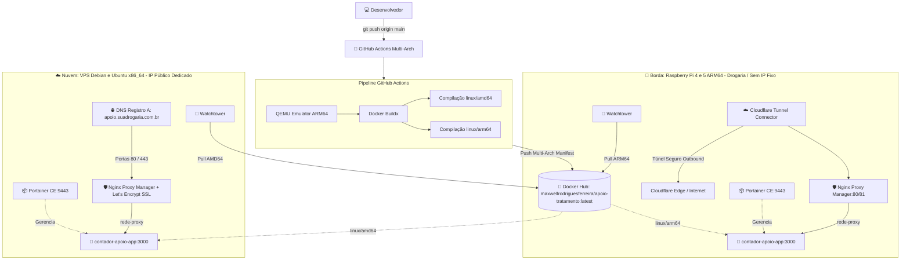

# Manual Prático de Implementação — Raspberry Pi (ARM64) & VPS Cloud (x86_64)

> Guia passo a passo completo para instalação, provisionamento, governança, pipeline CI/CD, proxy reverso e atualização contínua do sistema **Apoio ao Tratamento**.
> 
> * **Imagem Oficial no Docker Hub**: `maxwellrodriguesferreira/apoio-tratamento:latest` (multi-arch `linux/amd64` e `linux/arm64`).
> * **Automação de Build**: **GitHub Actions** com QEMU e Docker Buildx para compilação simultânea multiplataforma.
> * **Gestão Visual**: **Portainer CE** presente tanto na Raspberry Pi quanto na VPS.
> * **Proxy Reverso & SSL**: **Nginx Proxy Manager (NPM)** presente em ambos os ambientes.
> * **Roteamento Externo**:
>   * 🍓 **Raspberry Pi**: Utiliza **Cloudflare Tunnel (Zero Trust)** para contornar CGNAT sem abrir portas no roteador da farmácia.
>   * ☁️ **VPS**: **Não necessita de Cloudflare Tunnel**; utiliza IP público dedicado com apontamento direto via DNS (Registro A).
> 
> ☸️ **Procurando deploy com Kubernetes?** Acesse o [Manual de Implementação Kubernetes / K3s (Raspberry Pi & VPS)](MANUAL_IMPLEMENTACAO_K8S_RPI_VPS.md).

---

## 📑 Sumário

1. [Topologia e Arquitetura Comparativa](#1-topologia-e-arquitetura-comparativa)
2. [Requisitos Mínimos & Sistemas Recomendados](#2-requisitos-mínimos--sistemas-recomendados)
3. [Etapa 1: Instalação do Docker e Criação da Rede](#3-etapa-1-instalação-do-docker-e-criação-da-rede)
4. [Etapa 2: Instalação do Portainer CE (Ambos os Ambientes)](#4-etapa-2-instalação-do-portainer-ce-ambos-os-ambientes)
5. [Etapa 3: Instalação do Nginx Proxy Manager (NPM)](#5-etapa-3-instalação-do-nginx-proxy-manager-npm)
6. [Etapa 4: Roteamento de Rede — Cloudflare Tunnel (RPi) vs DNS Direto (VPS)](#6-etapa-4-roteamento-de-rede--cloudflare-tunnel-rpi-vs-dns-direto-vps)
7. [Etapa 5: Configuração do CI/CD no GitHub Actions & Docker Hub](#7-etapa-5-configuração-do-cicd-no-github-actions--docker-hub)
8. [Etapa 6: Configuração de Ambiente (.env) e Variáveis](#8-etapa-6-configuração-de-ambiente-env-e-variáveis)
9. [Etapa 7: Deploy da Aplicação (Portainer Stacks ou CLI)](#9-etapa-7-deploy-da-aplicação-portainer-stacks-ou-cli)
10. [Etapa 8: Atualização Contínua Automática com Watchtower](#10-etapa-8-atualização-contínua-automática-com-watchtower)
11. [Etapa 9: Rotinas de Backup, Monitoramento e Manutenção](#11-etapa-9-rotinas-de-backup-monitoramento-e-manutenção)
12. [Quadro Comparativo: Raspberry Pi vs VPS](#12-quadro-comparativo-raspberry-pi-vs-vps)

---

## 1. Topologia e Arquitetura Comparativa



### Principais Diferenças de Conectividade:
* **Raspberry Pi**: Opera dentro da rede física da farmácia, sob **CGNAT** da operadora, sem IP público fixo. O **Cloudflare Tunnel** é **obrigatório** para expor a aplicação na internet de forma segura com SSL e proteção DDoS, sem abrir portas no modem/roteador.
* **VPS**: Já possui **endereço IP público IPv4 estático**. O tráfego chega diretamente nas portas 80/443 do servidor, onde o **Nginx Proxy Manager** recebe a requisição, emite o certificado SSL Let's Encrypt automaticamente e repassa para a aplicação. O Cloudflare Tunnel é **desnecessário**.

---

## 2. Requisitos Mínimos & Sistemas Recomendados

| Especificação | Raspberry Pi 4 / 5 (Borda) | VPS Cloud (Hostinger, Hetzner, etc.) |
| :--- | :--- | :--- |
| **Arquitetura de CPU** | `arm64` / `aarch64` (ARM Cortex-A72 / A76) | `x86_64` / `amd64` (Intel Xeon / AMD EPYC) |
| **Memória RAM** | 2 GB ou 4 GB (recomendado 4 GB) | 1 GB ou 2 GB (recomendado 2 GB) |
| **Armazenamento** | 16 GB+ MicroSD classe A2 ou SSD USB 3.0 | 20 GB+ SSD NVMe |
| **Sistema Operacional** | **Raspberry Pi OS Lite 64-bit** (Debian Bookworm) | **Debian 12 Bookworm** ou **Ubuntu 24.04 LTS** |
| **Necessita Cloudflare Tunnel?** | **SIM** (Obrigatório devido ao CGNAT) | **NÃO** (Conexão direta via IP público) |
| **Possui Portainer e NPM?** | **SIM** | **SIM** |

> ⚠️ **Atenção para Raspberry Pi**: É obrigatório usar a versão **64-bit** do sistema operacional. O Node.js 24 Alpine e os binários criptográficos modernos não suportam kernel ou bibliotecas de 32 bits.

---

## 3. Etapa 1: Instalação do Docker e Criação da Rede

Execute os passos abaixo no terminal do servidor (seja ele a Raspberry Pi ou a VPS):

### 3.1. Atualizar o sistema operacional:
```bash
sudo apt update && sudo apt upgrade -y
sudo apt install -y curl wget git nano ca-certificates gnupg lsb-release
```

### 3.2. Otimizações para Raspberry Pi (Preservação do MicroSD e RAM):
Na Raspberry Pi, para evitar esgotamento de memória e proteger o cartão SD contra excesso de escritas:
```bash
# Ativa ZRAM (compressão dinâmica de RAM)
sudo apt install -y zram-tools
sudo tee /etc/default/zramswap << 'EOF'
ALGO=zstd
PERCENT=50
PRIORITY=100
EOF
sudo systemctl restart zramswap

# Reduz swap no disco para proteger o MicroSD
echo 'vm.swappiness=10' | sudo tee -a /etc/sysctl.conf
sudo sysctl -p
```

### 3.3. Instalar Docker Engine Oficial:
```bash
curl -fsSL https://get.docker.com -o get-docker.sh
sudo sh get-docker.sh
rm get-docker.sh

# Adicionar o usuário atual ao grupo docker (evita sudo)
sudo usermod -aG docker $USER
sudo systemctl enable --now docker
```
> *Feche e reabra o terminal SSH para ativar as permissões de grupo.*

### 3.4. Criar a Rede Docker Compartilhada (`rede-proxy`):
Todos os serviços (Portainer, Nginx Proxy Manager, Aplicação e Watchtower) se comunicarão através desta rede externa isolada:
```bash
docker network create rede-proxy 2>/dev/null || true
```

---

## 4. Etapa 2: Instalação do Portainer CE (Ambos os Ambientes)

O **Portainer Community Edition** permite gerenciar contêineres, stacks, logs, uso de memória e CPU via interface web intuitiva.

### 4.1. Criar o volume de dados e subir o contêiner do Portainer:
```bash
docker volume create portainer_data

docker run -d \
  --name=portainer \
  --restart=unless-stopped \
  -p 9000:9000 \
  -p 9443:9443 \
  -v /var/run/docker.sock:/var/run/docker.sock \
  -v portainer_data:/data \
  --network rede-proxy \
  portainer/portainer-ce:latest
```

### 4.2. Acesso ao Painel do Portainer:
1. Abra no navegador:
   * **Raspberry Pi**: `https://IP_LOCAL_DA_RASPBERRY:9443` *(ex: `https://192.168.1.150:9443`)*
   * **VPS**: `https://IP_PUBLICO_DA_VPS:9443`
2. No primeiro acesso, defina a senha do usuário `admin` (mínimo de 12 caracteres).
3. Selecione o ambiente local **Get Started (Local)**.

---

## 5. Etapa 3: Instalação do Nginx Proxy Manager (NPM)

O **Nginx Proxy Manager** será o ponto de entrada das requisições HTTP/HTTPS tanto na Raspberry Pi quanto na VPS.

### 5.1. Criar a pasta e o `compose` do NPM:
```bash
sudo mkdir -p /opt/npm && cd /opt/npm
sudo nano docker-compose.yml
```

Cole a configuração padrão do NPM:
```yaml
services:
  npm:
    image: jc21/nginx-proxy-manager:latest
    container_name: nginx-proxy-manager
    restart: unless-stopped
    ports:
      - "80:80"     # Tráfego HTTP público
      - "443:443"   # Tráfego HTTPS público
      - "81:81"     # Painel de Administração Web do NPM
    environment:
      - DISABLE_IPV6=true
    volumes:
      - npm_data:/data
      - npm_letsencrypt:/etc/letsencrypt
    networks:
      - rede-proxy

volumes:
  npm_data:
  npm_letsencrypt:

networks:
  rede-proxy:
    external: true
```

Inicie o Nginx Proxy Manager:
```bash
docker compose up -d
```

### 5.2. Primeiro Acesso ao Painel do NPM:
1. Acesse: `http://IP_DO_SERVIDOR:81`
2. Credenciais padrão de fábrica:
   * **Email**: `admin@example.com`
   * **Password**: `changeme`
3. Altere imediatamente seu nome, email e senha de administrador no primeiro login.

---

## 6. Etapa 4: Roteamento de Rede — Cloudflare Tunnel (RPi) vs DNS Direto (VPS)

---

### 🍓 Caso A: Raspberry Pi — Configuração do Cloudflare Tunnel via Docker (Obrigatório)

Como a Raspberry Pi opera conectada ao roteador da farmácia sem IP público fixo e sob **CGNAT**, utilizamos o **Cloudflare Tunnel** (gratuito) para criar um túnel seguro de saída (*outbound*) criptografado diretamente para a borda global da Cloudflare.

Executar o conector via **Docker** é o método mais simples, seguro e limpo, pois dispensa a instalação de pacotes no sistema operacional, reinicia automaticamente no boot e pode ser gerenciado diretamente pelo **Portainer**.

```text
[Cliente / Celular] ──HTTPS (SSL Cloudflare)──> [Cloudflare Edge (WAF/DDoS)] 
                                                        │
                                            (Túnel Seguro Outbound)
                                                        ▼
                                         [Contêiner cloudflared na RPi] 
                                                        │ (HTTP interno na rede-proxy)
                                                        ▼
                                            [Nginx Proxy Manager:80] 
                                                        │ (HTTP interno na rede-proxy)
                                                        ▼
                                            [contador-apoio-app:3000]
```

> 💡 **Como funciona o Certificado SSL neste cenário**:  
> Você **não precisa gerar certificado SSL Let's Encrypt no Nginx Proxy Manager (NPM)**.  
> A **Cloudflare emite e renova o certificado SSL/TLS automaticamente na borda (*Universal SSL*)**. O visitante acessa `https://apoio.suadrogaria.com.br` de forma 100% criptografada. O conector `cloudflared` recebe a requisição segura e a entrega internamente ao NPM via HTTP na rede Docker privada (`rede-proxy`). No painel do NPM, a aba SSL do host pode permanecer em **None**.

---

#### Método 1: Configuração 100% via Linha de Comando (CLI + Docker)

Neste método, você realiza o login, a criação do túnel e o apontamento do domínio pessoal no DNS da Cloudflare **direto pelo terminal**:

##### 1. Autenticar a CLI da Cloudflare via Docker:
Crie os diretórios de configuração e execute o login:
```bash
mkdir -p ~/.cloudflared
sudo mkdir -p /opt/cloudflared && cd /opt/cloudflared

# Executa o login temporário
docker run -it --rm \
  -v ~/.cloudflared:/root/.cloudflared \
  cloudflare/cloudflared:latest tunnel login
```
* O terminal exibirá uma URL de autorização (ex: `https://dash.cloudflare.com/argotunnel?...`).
* Abra a URL no navegador, escolha o seu domínio pessoal e autorize.
* O arquivo de certificado `cert.pem` será baixado automaticamente em `~/.cloudflared/cert.pem`.

##### 2. Criar o Túnel via CLI:
```bash
docker run --rm \
  -v ~/.cloudflared:/root/.cloudflared \
  cloudflare/cloudflared:latest tunnel create apoio-tunnel
```
O comando gerará o arquivo de credenciais e exibirá o UUID do túnel:
```text
Created tunnel apoio-tunnel with id 12345678-abcd-1234-abcd-1234567890ab
```

##### 3. Apontar o Domínio Pessoal no DNS via CLI:
Este comando cria **automaticamente o registro CNAME** no painel de DNS da Cloudflare apontando seu subdomínio para o túnel:
```bash
docker run --rm \
  -v ~/.cloudflared:/root/.cloudflared \
  cloudflare/cloudflared:latest tunnel route dns apoio-tunnel apoio.suadrogaria.com.br
```

##### 4. Criar o Arquivo de Rotas (`config.yml`):
Copie as credenciais para `/opt/cloudflared` e defina o direcionamento para o Nginx Proxy Manager:
```bash
sudo cp ~/.cloudflared/*.json /opt/cloudflared/tunnel-credentials.json
sudo nano /opt/cloudflared/config.yml
```

Cole o conteúdo (substitua pelo seu UUID):
```yaml
tunnel: 12345678-abcd-1234-abcd-1234567890ab
credentials-file: /etc/cloudflared/tunnel-credentials.json

ingress:
  # Encaminha o domínio público para o Nginx Proxy Manager na rede Docker
  - hostname: apoio.suadrogaria.com.br
    service: http://nginx-proxy-manager:80

  # Regra obrigatória de fallback (404)
  - service: http_status:404
```

##### 5. Subir o Contêiner do Túnel via Docker Compose:
Crie o arquivo `/opt/cloudflared/docker-compose.yml`:
```yaml
services:
  cloudflared:
    image: cloudflare/cloudflared:latest
    container_name: cloudflared-tunnel
    restart: unless-stopped
    command: tunnel run
    volumes:
      - ./config.yml:/etc/cloudflared/config.yml:ro
      - ./tunnel-credentials.json:/etc/cloudflared/tunnel-credentials.json:ro
    networks:
      - rede-proxy

networks:
  rede-proxy:
    external: true
```

Inicie o túnel:
```bash
docker compose up -d
```

---

#### Método 2: Configuração via Token do Painel Zero Trust + Portainer

Se você preferir obter o token do túnel pelo painel visual da Cloudflare e executá-lo via Portainer:

1. Acesse [Cloudflare Zero Trust](https://one.dash.cloudflare.com/) ➔ **Networks** ➔ **Tunnels** ➔ **Add a Tunnel**.
2. Escolha **Cloudflared**, defina o nome e selecione o ambiente **Docker**.
3. Copie o token exclusivo exibido após `--token`.
4. No **Portainer** (`https://IP_DA_RASPBERRY:9443`) ➔ **Stacks** ➔ **Add stack** (nome: `cloudflare-tunnel`):
   ```yaml
   services:
     tunnel:
       image: cloudflare/cloudflared:latest
       container_name: cloudflared-tunnel
       restart: unless-stopped
       command: tunnel --no-autoupdate run --token SEU_TOKEN_AQUI
       networks:
         - rede-proxy

   networks:
     rede-proxy:
       external: true
   ```
5. No painel da Cloudflare (aba **Public Hostname**), aponte:
   * **Hostname**: `apoio.suadrogaria.com.br`
   * **Service**: `HTTP` | **URL**: `nginx-proxy-manager:80`

---

#### Passo Final: Cadastrar o Proxy Host no Nginx Proxy Manager (Raspberry Pi)
No painel do NPM (`http://IP_DA_RASPBERRY:81`):
1. Acesse **Hosts** ➔ **Proxy Hosts** ➔ **Add Proxy Host**:
   * **Domain Names**: `apoio.suadrogaria.com.br`
   * **Scheme**: `http`
   * **Forward Hostname / IP**: `contador-apoio-app`
   * **Forward Port**: `3000`
   * Marque: **Block Common Exploits**, **Websockets Support** e **Cache Assets**.
2. **Aba SSL**: Mantenha em **None** (o SSL já é garantido na borda da Cloudflare).
3. Clique em **Save**. Pronto! Seu sistema estará operando com SSL A+ e proteção DDoS ativa.

---

### ☁️ Caso B: VPS — Apontamento de DNS Direto (Sem Cloudflare Tunnel)

A VPS possui **endereço IP público IPv4 fixo**. O Cloudflare Tunnel é **completamente desnecessário**.

#### Passo 1: Apontamento no Painel de DNS do seu Domínio:
Acesse o painel do seu domínio (Hostinger, Registro.br, Cloudflare, etc.) e crie um **Registro A**:
* **Tipo**: `A`
* **Nome / Host**: `apoio` (ou `@` para domínio raiz)
* **Valor / Destino**: `IP_PUBLICO_DA_SUA_VPS` (ex: `195.35.10.80`)
* **TTL**: `300` segundos

#### Passo 2: Criar o Proxy Host no Nginx Proxy Manager (NPM da VPS):
1. Acesse o NPM da VPS em `http://IP_DA_VPS:81`.
2. Vá em **Hosts** ➔ **Proxy Hosts** ➔ **Add Proxy Host**:
   * **Domain Names**: `apoio.suadrogaria.com.br`
   * **Scheme**: `http`
   * **Forward Hostname / IP**: `contador-apoio-app` *(nome do contêiner na rede `rede-proxy`)*
   * **Forward Port**: `3000`
   * Marque: **Block Common Exploits**, **Websockets Support** e **Cache Assets**.
3. Na aba **SSL**:
   * **SSL Certificate**: Selecione **Request a new SSL Certificate**.
   * Marque: **Force SSL**, **HTTP/2 Support** e preencha seu e-mail.
   * Aceite os termos do Let's Encrypt e clique em **Save**.

---

## 7. Etapa 5: Configuração do CI/CD no GitHub Actions & Docker Hub

Para que as alterações no código sejam compiladas automaticamente tanto para a **VPS (AMD64)** quanto para a **Raspberry Pi (ARM64)** e publicadas no Docker Hub:

### 7.1. Gerar o Personal Access Token no Docker Hub:
1. Acesse sua conta em [hub.docker.com](https://hub.docker.com/).
2. Clique no seu avatar no canto superior direito ➔ **Account Settings**.
3. No menu lateral, clique em **Security** ➔ **New Access Token**.
4. Defina:
   * **Description**: `github-actions-ci-cd`
   * **Access permissions**: `Read & Write`
5. Clique em **Generate** e copie o token gerado (começa com `dckr_pat_...`).

### 7.2. Configurar os Secrets no Repositório GitHub:
1. Abra seu repositório no GitHub (`github.com/seu-usuario/contador-apoio-tratamento`).
2. Vá em **Settings** ➔ **Secrets and variables** ➔ **Actions**.
3. Clique em **New repository secret** e cadastre os seguintes segredos:

| Nome do Segredo | Obrigatório? | Valor / Descrição |
| :--- | :---: | :--- |
| `DOCKERHUB_USERNAME` | **Sim** | Seu nome de usuário do Docker Hub (ex: `maxwellrodriguesferreira`) |
| `DOCKERHUB_TOKEN` | **Sim** | O token de acesso pessoal gerado (`dckr_pat_...`) |
| `WATCHTOWER_WEBHOOK_URL` | *Opcional* | URL do webhook do Watchtower para atualização instantânea |
| `WATCHTOWER_HTTP_API_TOKEN`| *Opcional* | Token Bearer caso a API do Watchtower exija autenticação |

### 7.3. Como Funciona a Pipeline Multi-Arquitetura:
O arquivo de workflow já está pronto no projeto em:
👉 [`.github/workflows/deploy.yml`](.github/workflows/deploy.yml)

A pipeline executa automaticamente a cada `git push` na branch `main`:
1. **QEMU**: Emula a arquitetura ARM64 em servidores de compilação da nuvem.
2. **Docker Buildx**: Compila o frontend React e backend Express em paralelo para:
   * `linux/amd64` (Servidores VPS Intel/AMD).
   * `linux/arm64` (Raspberry Pi 3/4/5).
3. **Manifesto Multi-Plataforma**: Envia um único pacote ao Docker Hub com a tag `:latest`. Quando a Raspberry Pi ou a VPS faz `docker compose pull`, o Docker detecta automaticamente a arquitetura do processador e baixa a imagem nativa correta.
4. **Cache Inteligente (`type=gha`)**: Reutiliza camadas compiladas anteriormente, reduzindo o tempo de build para menos de 1 minuto.

### 7.4. Disparar e Testar o Workflow:
* **Disparo Automático**: Qualquer `git push origin main` inicia a compilação.
* **Disparo Manual**: Acesse a aba **Actions** no GitHub ➔ Selecione **CI/CD Pipeline** ➔ Clique em **Run workflow**.

Para inspecionar a imagem gerada no Docker Hub e certificar-se de que ambas as arquiteturas estão presentes:
```bash
docker buildx imagetools inspect maxwellrodriguesferreira/apoio-tratamento:latest
```

---

## 8. Etapa 6: Configuração de Ambiente (.env) e Variáveis

Tanto na Raspberry quanto na VPS, crie o diretório oficial da aplicação e o arquivo `.env`:

```bash
sudo mkdir -p /opt/apoio-tratamento
sudo chown -R $USER:$USER /opt/apoio-tratamento
cd /opt/apoio-tratamento
nano .env
```

Cole o modelo de configuração abaixo:

```env
# ==============================================================================
# Variáveis de Ambiente — Apoio ao Tratamento
# ==============================================================================

# Rede e Portas
DOCKER_SHARED_NETWORK=rede-proxy
APP_PORT=3000
PORT=3000
NODE_ENV=production

# Banco de Dados Cloudflare D1 (Produção)
# (Se omitido, o sistema opera automaticamente com o SQLite local persistido em /app/data)
CLOUDFLARE_ACCOUNT_ID=seu_account_id_cloudflare_aqui
CLOUDFLARE_DATABASE_ID=seu_database_id_uuid_aqui
CLOUDFLARE_API_TOKEN=seu_token_api_cloudflare_aqui

# Inteligência Artificial Google Gemini
GEMINI_API_KEY=sua_chave_gemini_aqui
GEMINI_DEFAULT_MODEL=gemini-3.6-flash

# Credenciais do Administrador
ADMIN_EMAIL=admin@suadrogaria.com.br
ADMIN_PASSWORD=SuaSenhaForteSegura123$

# Rate Limiting e Cache Distribuído (Upstash Redis - Opcional)
REDIS_URL=
LOGIN_RATE_LIMIT_MAX=5
LOGIN_RATE_LIMIT_WINDOW_MS=900000

# Persistência Local
DATABASE_DIR=/app/data
```

Proteja o arquivo com permissão restrita de leitura:
```bash
chmod 600 .env
```

---

## 9. Etapa 7: Deploy da Aplicação (Portainer Stacks ou CLI)

A imagem multi-arquitetura já está publicada e disponível no Docker Hub:
```text
maxwellrodriguesferreira/apoio-tratamento:latest
```

Você pode implantar de duas maneiras:

### Opção A: Deploy pelo Painel do Portainer (Interface Gráfica)
1. Acesse seu Portainer (`https://IP:9443`).
2. No menu lateral, clique em **Stacks** ➔ **Add stack**.
3. Nome da Stack: `apoio-tratamento`.
4. Em **Build method**, selecione **Web editor** e cole o conteúdo do `docker-compose.yml` (abaixo).
5. Role até a seção **Environment variables**, clique em **Load variables from .env file** e envie o seu arquivo `.env` (ou cole as variáveis manualmente).
6. Clique no botão azul **Deploy the stack**.

---

### Opção B: Deploy via Linha de Comando (CLI)
Crie o arquivo `/opt/apoio-tratamento/docker-compose.yml`:

```yaml
services:
  # ----------------------------------------------------------------------------
  # Aplicação Unificada (Frontend React SPA + Backend Express + D1 Engine)
  # ----------------------------------------------------------------------------
  app:
    image: maxwellrodriguesferreira/apoio-tratamento:latest
    container_name: contador-apoio-app
    restart: unless-stopped
    ports:
      - "${APP_PORT:-3000}:${PORT:-3000}"
    env_file:
      - path: .env
        required: true
    environment:
      - NODE_ENV=production
      - PORT=3000
      - CLIENT_BUILD_PATH=/app/client
      - DATABASE_DIR=/app/data
    volumes:
      - d1_sqlite_data:/app/data
    healthcheck:
      test: [ "CMD", "node", "-e", "fetch('http://localhost:' + (process.env.PORT || 3000) + '/api/health').then(r => r.ok ? process.exit(0) : process.exit(1)).catch(() => process.exit(1))" ]
      interval: 15s
      timeout: 5s
      retries: 3
      start_period: 10s
    networks:
      - rede-proxy
    labels:
      - "com.centurylinklabs.watchtower.enable=true"

  # ----------------------------------------------------------------------------
  # Agente Watchtower — Atualização Automática Contínua
  # ----------------------------------------------------------------------------
  watchtower:
    image: containrrr/watchtower:latest
    container_name: contador-apoio-watchtower
    restart: unless-stopped
    volumes:
      - /var/run/docker.sock:/var/run/docker.sock
    environment:
      - WATCHTOWER_CLEANUP=true
      - WATCHTOWER_POLL_INTERVAL=300
      - WATCHTOWER_INCLUDE_RESTARTING=true
      - WATCHTOWER_LABEL_ENABLE=true
      - DOCKER_API_VERSION=1.44
    networks:
      - rede-proxy

volumes:
  d1_sqlite_data:
    name: contador_apoio_d1_data

networks:
  rede-proxy:
    name: ${DOCKER_SHARED_NETWORK:-rede-proxy}
    external: true
```

Inicie o serviço:
```bash
docker compose pull
docker compose up -d
```

### Validar se a aplicação subiu com sucesso:
```bash
docker compose ps
curl http://localhost:3000/api/health
```

---

## 10. Etapa 8: Atualização Contínua Automática com Watchtower

Graças ao contêiner **Watchtower** incluído na stack:
1. Ao realizar alterações no código e enviar para o GitHub (`git push origin main`), o GitHub Actions compila automaticamente as versões `arm64` e `amd64` e publica no Docker Hub.
2. A cada 5 minutos (`WATCHTOWER_POLL_INTERVAL=300`), o Watchtower presente na Raspberry Pi e na VPS verifica o Docker Hub.
3. Se detectar uma nova imagem `:latest`, ele baixa a versão compatível com a máquina, encerra a versão anterior suavemente e inicia o novo contêiner preservando o volume persistente de dados.

Você pode acompanhar as atualizações diretamente pelos logs do Portainer ou pelo terminal:
```bash
docker logs -f contador-apoio-watchtower
```

---

## 11. Etapa 9: Rotinas de Backup, Monitoramento e Manutenção

### 11.1. Visualização e Diagnóstico via Portainer
* **Status dos Contêineres**: Acesse **Containers** no Portainer para verificar saúde (`healthy`), portas e status.
* **Logs em Tempo Real**: Clique no ícone de documento ao lado do contêiner `contador-apoio-app` para acompanhar requisições.
* **Métricas de Consumo**: Clique no ícone de gráfico para visualizar uso de memória RAM e CPU em tempo real.

### 11.2. Backup Automatizado do Volume SQLite Local
Se você utilizar a persistência nativa em SQLite (`contador_apoio_d1_data`), configure um backup diário:

```bash
sudo tee /usr/local/bin/backup-apoio-tratamento.sh << 'EOF'
#!/bin/bash
BACKUP_DIR="/var/backups/apoio-tratamento"
DATE=$(date +%Y%m%d_%H%M%S)
mkdir -p "$BACKUP_DIR"

docker run --rm \
  -v contador_apoio_d1_data:/source:ro \
  -v "$BACKUP_DIR":/backup \
  alpine tar -czf "/backup/backup_apoio_${DATE}.tar.gz" -C /source .

# Mantém apenas os últimos 30 dias de backup
find "$BACKUP_DIR" -type f -name "backup_apoio_*.tar.gz" -mtime +30 -delete
EOF

sudo chmod +x /usr/local/bin/backup-apoio-tratamento.sh
(crontab -l 2>/dev/null; echo "0 3 * * * /usr/local/bin/backup-apoio-tratamento.sh") | crontab -
```

---

## 12. Quadro Comparativo: Raspberry Pi vs VPS

| Aspecto | 🍓 Raspberry Pi 4 / 5 | ☁️ VPS Cloud |
| :--- | :--- | :--- |
| **Imagem Utilizada** | `maxwellrodriguesferreira/apoio-tratamento:latest` (`arm64`) | `maxwellrodriguesferreira/apoio-tratamento:latest` (`amd64`) |
| **Hospedagem da Imagem** | Docker Hub Oficial | Docker Hub Oficial |
| **Compilação CI/CD** | **GitHub Actions** (QEMU + Buildx Multi-Arch) | **GitHub Actions** (QEMU + Buildx Multi-Arch) |
| **Gerenciador Visual** | **Portainer CE** (porta 9443) | **Portainer CE** (porta 9443) |
| **Proxy Reverso** | **Nginx Proxy Manager** | **Nginx Proxy Manager** |
| **Cloudflare Tunnel** | **SIM (Obrigatório)**: Supera o CGNAT residencial/farmácia sem abrir portas | **NÃO (Desnecessário)**: Tráfego direto via IP público IPv4 estático |
| **Certificado SSL** | Gerenciado via Cloudflare Edge | Gerenciado via Let's Encrypt no Nginx Proxy Manager |
| **Custo Mensal** | R$ 0,00 (apenas energia elétrica ~5W) | R$ 25 a R$ 60 / mês |
| **Cenário Ideal** | Drogaria única com operação local autônoma e baixo custo | Redes com múltiplas lojas e acessos externos simultâneos |

---
*Manual elaborado para implantação de alta disponibilidade e gestão unificada via GitHub Actions, Portainer e NPM.*
