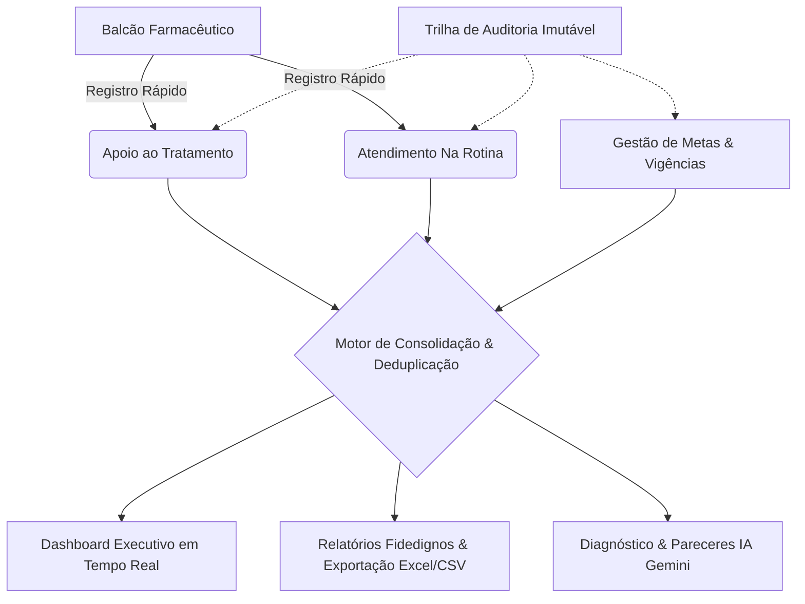

# Apoio ao Tratamento & Serviços Farmacêuticos — Gestão Clínica, Metas & IA Operacional

> Plataforma corporativa de alta performance desenvolvida para redes farmacêuticas e drogarias. Centraliza o registro de intervenções clínicas, acompanhamento farmacoterapêutico (Apoio ao Tratamento), atendimentos contínuos (Na Rotina), governança de metas com versionamento temporal, auditoria imutável e análise preditiva integrada ao Google Gemini.

[](Dockerfile)
[](https://nodejs.org/)
[](https://react.dev/)
[](https://www.typescriptlang.org/)
[](https://developers.cloudflare.com/d1/)
[](https://ai.google.dev/)
[-success.svg)](vitest.config.ts)
[](k8s/)

---

## 📌 Visão Geral do Sistema

O sistema foi desenhado para atender às exigências reais do balcão farmacêutico e da gestão executiva de drogarias, combinando velocidade operacional no atendimento com rigor estatístico, segurança e auditoria completa de dados:



---

## 🚀 Resumo das Funcionalidades

| Módulo | Funcionalidade | Descrição Resumida |
| :--- | :--- | :--- |
| 📊 **Dashboard Executivo** | **Monitoramento em Tempo Real** | Visão instantânea de KPIs consolidados: total de atendimentos hoje e no mês, termômetro clínico de progresso, ritmo diário necessário, projeção mensal linear e ranking da equipe. |
| 📊 **Dashboard Executivo** | **Metas Reativas & Zeramento** | Suporte dinâmico a metas operacionais: reflete instantaneamente metas ativas ou zeradas sem apresentar valores fictícios de fallback. |
| 💊 **Apoio ao Tratamento** | **Registro Clínico Rápido** | Formulário otimizado para cadastro ágil de adesão farmacoterapêutica, validação estrita via esquemas Zod e controle de versão contra edição concorrente. |
| 📋 **Atendimento Na Rotina** | **Serviços Farmacêuticos Contínuos** | Controle dedicado de atendimentos rotineiros e serviços rápidos em balcão, desacoplado de metas compulsórias para incentivar o registro fidedigno. |
| 📝 **Menu de Lançamentos** | **Histórico Unificado & Auditoria** | Listagem cronológica consolidada de Apoio e Rotina, busca textual, filtros avançados por período/atendente e controle de concorrência otimista. |
| 📝 **Menu de Lançamentos** | **Limpeza & Gestão de Registros** | Recurso administrativo avançado de **Limpeza de Lançamentos**: permite apagar ou mover para a lixeira registros em massa (todos, período filtrado ou apenas lixeira) com opção de purga definitiva (Hard Delete) ou exclusão lógica (Soft Delete). |
| 🎯 **Metas Operacionais** | **Versionamento & Edição Completa** | Painel com suporte a metas diárias e mensais (loja e individuais). Permite **editar metas vigentes**, prorrogar ou encerrar períodos, preservar histórico temporal e **refazer/limpar metas do zero** com sincronização imediata. |
| 📈 **Relatórios & Comparativos** | **Fidelidade Analítica & Multisserviço** | Relatórios detalhados com seletor de serviço (**Apoio ao Tratamento**, **Na Rotina** ou **Consolidado Geral**), deduplicação matemática (`filterValidRecords`), ciclos mensais 100% dinâmicos e exportação para **Excel (.xlsx)** e **CSV**. |
| 🤖 **Inteligência Artificial** | **Google Gemini Flash** | Diagnósticos operacionais automatizados, identificação de gargalos de adesão terapêutica e plano de ação sugerido para liderança. Conta com cache determinístico (`input_hash`) e invalidação atômica ao modificar registros. |
| 🛡️ **Auditoria (Audit Trail)** | **Rastreabilidade Imutável** | Trilha detalhada de conformidade: registra data/hora, IP, identidade do usuário, ação e snapshots completos de estado anterior (`old_value`) e novo (`new_value`) para mutações (`CREATE`, `UPDATE`, `DELETE`, `RESTORE`). |
| 👥 **Usuários & Equipe** | **Controle de Acesso RBAC** | Cadastro e gerenciamento de atendentes e administradores, bloqueio de credenciais inativas e redefinição de senhas com hashing criptográfico seguro. |
| ☁️ **Sincronização Híbrida** | **Dual Engine em Tempo Real** | Banco na nuvem **Cloudflare D1 (Edge SQL)** com persistência local e fallback automático para **SQLite** nativo, integrado a barramento de eventos em tempo real (`CloudSyncService`). |

---

## 🔐 Controle de Acesso Baseado em Papéis (RBAC)

O sistema adota o princípio de menor privilégio e separação estrita de funções:

| Ação / Módulo | Administrador (`ADMIN`) | Atendente (`ATENDENTE`) |
| :--- | :---: | :---: |
| Visualizar Dashboard Consolidado | ✅ Total | 👁️ Somente Leitura (Individual) |
| Registrar Novo Apoio ao Tratamento | ✅ Sim | ❌ Restrito |
| Registrar Atendimento Na Rotina | ✅ Sim | ❌ Restrito |
| Editar / Excluir / Restaurar Lançamentos | ✅ Sim | ❌ Restrito |
| Limpar Lançamentos (Hard/Soft Delete em lote) | ✅ Sim | ❌ Restrito |
| Configurar, Editar e Zerar Metas | ✅ Sim | ❌ Restrito |
| Gerar Diagnósticos Executivos por IA | ✅ Sim | ❌ Restrito |
| Acessar Relatórios & Exportar Dados | ✅ Sim | ❌ Restrito |
| Consultar Trilha de Auditoria Imutável | ✅ Sim | ❌ Restrito |
| Gestão de Usuários e Atendentes | ✅ Sim | ❌ Restrito |
| Consultar Perfil Pessoal | ✅ Sim | ✅ Sim |

---

## 🛠️ Stack Tecnológica

* **Frontend**: React 18, TypeScript 5.8, Vite, Tailwind CSS, Material Symbols, Recharts (gráficos reativos) e Zod.
* **Backend Integrado**: Node.js 24 Alpine, TypeScript, Express 4.x com rotas REST autenticadas (`/api/*`), PBKDF2 com Salt aleatório para senhas e tokens JWT seguros.
* **Bancos de Dados**: **Cloudflare D1** (Edge SQL distribuído) + **SQLite** nativo persistido (`node:sqlite`) com sincronização bidirecional resiliente.
* **Inteligência Artificial**: **Google Gemini 3.6 Flash** integrado via API REST com prompts técnicos especializados em farmácia clínica e governança de metas.
* **Infraestrutura**: Contêiner único (*Single Container*) leve, seguro (execução como usuário não-root `node`), orquestrado via Docker Compose ou Kubernetes / K3s.
* **Qualidade de Software**: 100% coberto por suíte de testes automatizados com **Vitest** (47 testes unitários e de integração aprovados).

---

## ⚡ Início Rápido

### 1. Clonar o Repositório e Configurar Ambiente
```bash
git clone https://github.com/maxwellrodriguesferreira/contador-apoio-tratamento.git
cd contador-apoio-tratamento
cp .env.example .env
```

> Configure as variáveis no `.env` (credenciais de Administrador, chave opcional do Google Gemini e chaves Cloudflare D1 caso utilize nuvem remota). Se omitir as chaves da Cloudflare, o sistema opera de forma autônoma com o banco SQLite local persistido em volume.

### 2. Execução com Docker Compose
```bash
# Inicia a aplicação em segundo plano com build automático
docker compose up -d --build
```

Acesse no navegador: **`http://localhost:3000`**

### 3. Validação de Saúde da API
```bash
curl http://localhost:3000/api/health
```

---

## 🧪 Testes Automatizados

O projeto conta com rigorosos testes de unidade, integração, RBAC e segurança matemática:

```bash
# Executa todos os testes com Vitest
npm test

# Executa testes em modo watch interativo
npm run test:watch
```

---

## 📚 Documentações Técnicas e Manuais de Implantação

* 🏛️ **[Arquitetura Detalhada do Sistema](ARCHITECTURE.md)**: Diagramas, modelos relacionais de dados e fluxo do motor de sincronização.
* 🚀 **[Deploy Contínuo e CI/CD](README_CICD_WATCHTOWER.md)**: Automação completa com GitHub Actions, Docker Hub e Watchtower.
* 🍓☁️ **[Manual Docker: Raspberry Pi & VPS](MANUAL_IMPLEMENTACAO_RPI_VPS.md)**: Guia completo de deploy com Docker Standalone, Portainer e Watchtower.
* ☸️ **[Manual Kubernetes / K3s (Raspberry Pi & VPS)](MANUAL_IMPLEMENTACAO_K8S_RPI_VPS.md)**: Deploy em cluster K3s, armazenamento local persistente, Cloudflare Tunnel in-cluster e certificados SSL Let's Encrypt.
* ☸️ **[Manifestos Kubernetes Declarativos](k8s/README.md)**: Documentação dos manifests K8s/K3s prontos para produção.
* 🔒 **[Relatórios de Segurança e Auditoria](reports/security/)**: Documentação técnica e executiva de auditoria de segurança e testes de invasão.

---

## 👨‍⚕️ Autoria e Responsabilidade Técnica

* **Desenvolvedor & Responsável Técnico**: **Maxwell Rodrigues Ferreira**
* **Registro Profissional**: **CRF-SP: 86426**
* **Imagem Oficial no Docker Hub**: [`maxwellrodriguesferreira/apoio-tratamento:latest`](https://hub.docker.com/r/maxwellrodriguesferreira/apoio-tratamento)

---

*Desenvolvido sob padrões corporativos para farmácias e drogarias. Todos os direitos reservados.*
