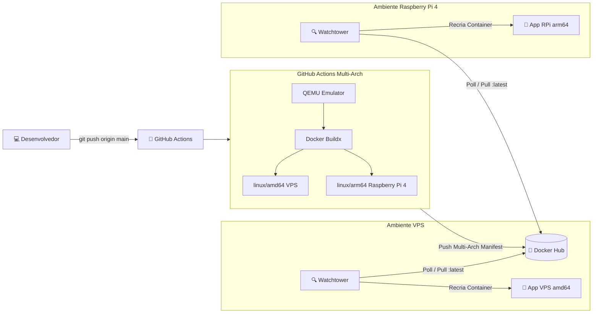

# Guia de CI/CD: GitHub Actions, Docker Hub & Watchtower

Este guia descreve como configurar e operar o fluxo de **Integração e Entrega Contínua (CI/CD)** do sistema **Apoio ao Tratamento**, com compilação multiplataforma (**Intel/AMD x86_64** para VPS e **ARM64** para Raspberry Pi 4) e atualização automática contínua via **Watchtower**.

---

## 1. Visão Geral da Arquitetura



### Como Funciona o Ciclo:
1. Você desenvolve uma alteração no código e faz `git push` para a branch `main`.
2. O **GitHub Actions** dispara automaticamente a pipeline.
3. Usando **QEMU** e **Docker Buildx**, ele compila o frontend e o backend para **VPS (`amd64`)** e **Raspberry Pi 4 (`arm64`)**.
4. O manifesto unificado multiplataforma é publicado no **Docker Hub**.
5. O **Watchtower** (rodando na VPS ou na Raspberry) detecta que uma nova versão da imagem `:latest` foi publicada.
6. O Watchtower faz o download da nova imagem correspondente à sua arquitetura, encerra o contêiner antigo suavemente e recria o novo mantendo os dados intactos.

---

## 2. Passo 1: Configurar Credenciais no GitHub (Secrets)

Para que o GitHub Actions consiga enviar as imagens para a sua conta do Docker Hub:

### A. Gerar o Token no Docker Hub
1. Acesse sua conta no [Docker Hub](https://hub.docker.com/).
2. No menu do seu perfil (canto superior direito), clique em **Account Settings**.
3. No menu lateral esquerdo, vá em **Security** ➔ **New Access Token**.
4. Dê uma descrição (ex: `github-actions-ci-cd`), marque permissões de **Read & Write** e clique em **Generate**.
5. Copie o token gerado (ele começará com `dckr_pat_...`).

### B. Adicionar os Segredos no Repositório do GitHub
1. Abra seu repositório no GitHub: `github.com/seu-usuario/contador-apoio-tratamento`.
2. Vá na aba **Settings** (Configurações) ➔ No menu lateral, clique em **Secrets and variables** ➔ **Actions**.
3. Clique no botão verde **New repository secret** e crie os dois seguintes:
   * **Nome:** `DOCKERHUB_USERNAME` *(Obrigatório)*  
     **Valor:** Seu usuário do Docker Hub (ex: `maxwellrodriguesferreira`).
   * **Nome:** `DOCKERHUB_TOKEN` *(Obrigatório)*  
     **Valor:** O token de acesso pessoal gerado no passo anterior.

   > 💡 **Segredos Opcionais para Disparo Imediato via Webhook**:
   > * **`WATCHTOWER_WEBHOOK_URL`** *(Opcional)*: URL do endpoint HTTP do Watchtower no seu servidor (ex: `https://watchtower.seuservidor.com.br/v1/update`). Se não configurado, o Watchtower atualizará normalmente através do polling periódico de 5 minutos.
   > * **`WATCHTOWER_HTTP_API_TOKEN`** *(Opcional)*: Token Bearer caso a API HTTP do seu Watchtower esteja protegida por autenticação.

---

## 3. Passo 2: O Pipeline do GitHub Actions

O arquivo de pipeline já está configurado no repositório em:
👉 [`.github/workflows/deploy.yml`](.github/workflows/deploy.yml)

### Destaques do Pipeline:
* **Acionamento Automático:** Executado a cada `push` na branch `main` (ignora edições em arquivos `.md`, documentação ou `.pdf`).
* **Disparo Manual:** Pode ser acionado sob demanda através do botão *Run workflow* na aba **Actions** do GitHub.
* **Multi-Arquitetura Nativas:** Compilação paralela para:
  * `linux/amd64` (Servidores Hostinger, VPS, computadores Intel/AMD).
  * `linux/arm64` (Raspberry Pi 3, 4, 5 e servidores ARM).
* **Camadas em Cache:** Utiliza o cache nativo do GitHub Actions (`type=gha`) para que os builds subsequentes levem apenas segundos.

---

## 4. Passo 3: Executar o Watchtower no Servidor (VPS ou Raspberry Pi 4)

No seu servidor (VPS ou Raspberry Pi 4), você utilizará o arquivo de orquestração:
👉 [`docker-compose.watchtower.yaml`](docker-compose.watchtower.yaml)

### Conteúdo do Arquivo:
```yaml
services:
  app:
    image: maxwellrodriguesferreira/apoio-tratamento:latest
    container_name: contador-apoio-app
    restart: unless-stopped
    ports:
      - "${APP_PORT:-3000}:${PORT:-3000}"
    expose:
      - "${PORT:-3000}"
    env_file:
      - path: .env
        required: false
    environment:
      - NODE_ENV=production
      - PORT=3000
      - CLIENT_BUILD_PATH=/app/client
      - DATABASE_DIR=/app/data
      - REDIS_URL=${REDIS_URL:-}
      - CLOUDFLARE_ACCOUNT_ID=${CLOUDFLARE_ACCOUNT_ID:-}
      - CLOUDFLARE_DATABASE_ID=${CLOUDFLARE_DATABASE_ID:-}
      - CLOUDFLARE_API_TOKEN=${CLOUDFLARE_API_TOKEN:-}
      - GEMINI_API_KEY=${GEMINI_API_KEY:-}
      - GEMINI_DEFAULT_MODEL=${GEMINI_DEFAULT_MODEL:-gemini-3.6-flash}
      - ADMIN_EMAIL=${ADMIN_EMAIL:-}
      - ADMIN_PASSWORD=${ADMIN_PASSWORD:-}
      - ATENDENTE_EMAIL=${ATENDENTE_EMAIL:-}
      - ATENDENTE_PASSWORD=${ATENDENTE_PASSWORD:-}
    volumes:
      - d1_sqlite_data:/app/data
    networks:
      - rede-proxy
    labels:
      - "com.centurylinklabs.watchtower.enable=true"

  watchtower:
    image: containrrr/watchtower:latest
    container_name: contador-apoio-watchtower
    restart: unless-stopped
    volumes:
      - /var/run/docker.sock:/var/run/docker.sock
    environment:
      - DOCKER_API_VERSION=1.44      # Garante compatibilidade com Docker moderno
      - WATCHTOWER_POLL_INTERVAL=300 # Verifica novidades a cada 5 minutos
      - WATCHTOWER_CLEANUP=true      # Remove imagens antigas para poupar disco
      - WATCHTOWER_LABEL_ENABLE=true # Monitora apenas contêineres autorizados
      - WATCHTOWER_ROLLING_RESTART=true
      - TZ=America/Sao_Paulo
    networks:
      - rede-proxy

volumes:
  d1_sqlite_data:
    name: contador_apoio_d1_data

networks:
  rede-proxy:
    name: rede-proxy
    external: true
```

### Como Iniciar no Servidor:
1. Certifique-se de que a rede `rede-proxy` existe no host:
   ```bash
   docker network create rede-proxy || true
   ```
2. Crie ou copie o arquivo `.env` com suas credenciais (Cloudflare, Upstash Redis, senhas).
3. Inicie a stack com o Watchtower:
   ```bash
   docker compose -f docker-compose.watchtower.yaml up -d
   ```

---

## 5. Passo 4: Testando o Fluxo de Ponta a Ponta

Para verificar a automação em funcionamento:

1. Faça uma alteração no código no seu computador local (ex: altere um texto ou adicione uma funcionalidade).
2. Faça o commit e envie para o GitHub:
   ```bash
   git add .
   git commit -m "feat: atualiza componentes do dashboard"
   git push origin main
   ```
3. Abra a aba **Actions** no seu GitHub: você verá o job `Build & Push Multi-Plataforma` sendo executado.
4. Quando o GitHub Actions finalizar, a nova imagem já estará no Docker Hub.
5. Em no máximo 5 minutos (intervalo configurado em `WATCHTOWER_POLL_INTERVAL`), o Watchtower na sua VPS e na sua Raspberry Pi baixará a nova versão e reiniciará o aplicativo automaticamente!

---

## 6. Comandos de Diagnóstico e Monitoramento

* **Verificar os logs do Watchtower (para ver quando ele atualizou o contêiner):**
  ```bash
  docker logs -f contador-apoio-watchtower
  ```
  *Exemplo de log do Watchtower:*
  ```text
  Found new maxwellrodriguesferreira/apoio-tratamento:latest image (sha256:...)
  Stopping /contador-apoio-app (6b710cfbc4d5) with SIGTERM
  Creating /contador-apoio-app
  Removing image sha256:...
  ```

* **Verificar logs da aplicação:**
  ```bash
  docker logs -f contador-apoio-app
  ```

* **Forçar checagem imediata sem esperar os 5 minutos:**
  ```bash
  docker restart contador-apoio-watchtower
  ```
