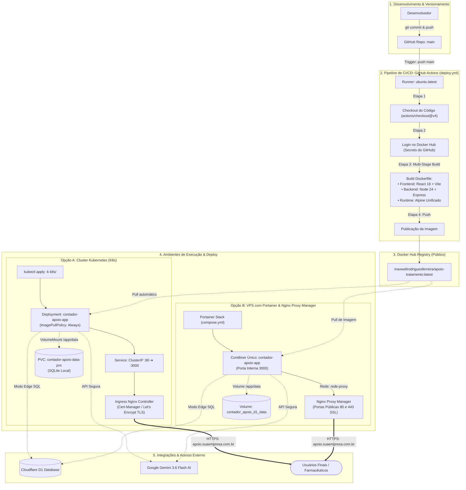

# Manifestos Kubernetes — Apoio ao Tratamento

Guia completo para orquestração e deploy da aplicação **Apoio ao Tratamento** em clusters Kubernetes (k3s, k8s vanilla, EKS, GKE, AKS, Minikube ou MicroK8s).

---

## 1. Visão Geral da Arquitetura em Kubernetes

A aplicação opera no modelo **Single-Container Unificado**:
* **Frontend SPA**: React 18 + Vite + Tailwind CSS (compilado e servido estaticamente pelo Express).
* **Backend API REST**: Express em Node.js 24 Alpine escutando internamente na porta `3000`.
* **Banco de Dados Híbrido**:
  * **Modo Edge (Nuvem)**: Conexão direta com a API do Cloudflare D1 via credenciais seguras.
  * **Modo Local (Offline/Fallback)**: SQLite 3 nativo em `/app/data` com conformidade ACID e WAL (*Write-Ahead Logging*).
* **Persistência**: PersistentVolumeClaim montado em `/app/data` para reter o banco SQLite local e migrações.
* **Segurança e Privilégios**: Execução com usuário sem privilégios de root (`node`, UID 1000, GID 1000) com `fsGroup: 1000` garantindo acesso estrito ao volume persistente.
* **Saúde e Resiliência**: Probes nativas de `startupProbe`, `readinessProbe` e `livenessProbe` apontando para `/api/health`.

### Fluxo de Implementação e Pipeline de CI/CD



---


## 2. Estrutura dos Arquivos

```text
k8s/
├── namespace.yaml         # Namespace isolado (contador-apoio)
├── configmap.yaml         # Variáveis de ambiente operacionais não sensíveis
├── secret.example.yaml    # Modelo com placeholders para credenciais seguras
├── pvc.yaml               # PersistentVolumeClaim (2Gi) para o diretório /app/data
├── deployment.yaml        # Deployment com réplica única, probes e segurança
├── service.yaml           # Service ClusterIP (Porta 80 -> Target 3000)
├── ingress.yaml           # Ingress com suporte a TLS, Cert-Manager e Let's Encrypt
├── kustomization.yaml     # Agregador declarativo Kustomize
└── README.md              # Documentação técnica e operacional
```

---

## 3. Passo a Passo para Implantação

### Passo 1: Criação do Namespace
```bash
kubectl apply -f k8s/namespace.yaml
```

### Passo 2: Configuração dos Segredos (Secret)

**Opção A (A partir do arquivo `.env` existente):**
```bash
kubectl create secret generic contador-apoio-secret \
  --from-env-file=.env \
  --namespace=contador-apoio
```

**Opção B (Via arquivo YAML):**
```bash
cp k8s/secret.example.yaml k8s/secret.yaml
# Edite k8s/secret.yaml e aplique:
kubectl apply -f k8s/secret.yaml
```

### Passo 3: Ajuste do Domínio no Ingress
Edite `k8s/ingress.yaml` e ajuste `apoio.seudominio.com.br` para o seu domínio real.

### Passo 4: Aplicação dos Recursos com Kustomize
```bash
kubectl apply -k k8s/
```

---

## 4. Diagnóstico e Verificação

```bash
# Status dos recursos
kubectl get all,pvc,ingress -n contador-apoio

# Logs em tempo real
kubectl logs -f deployment/contador-apoio-app -n contador-apoio
```
